# Chrome Extension Base

UI を SolidJS で構成する Manifest V3 の Chrome 拡張スターターです。
TypeScript + Vite + Vitest、SolidJS 1.9 と daisyUI 5 + Tailwind CSS 4 で構成しています。
メモの保存、[SampleAPIs](https://api.sampleapis.com/) の REST 取得、設定の保存・リセット、
現在のページ情報の取得、ストレージ変更への UI の追従を含みます。
service worker へのメッセージ通信、右クリックメニュー、キーボードショートカット、アラーム（定期実行）、ツールバーのバッジ、
インストール時の案内ページ、ページに注入する content script、
ページの CSS から隔離した通知の表示（Shadow DOM）、設定の書き出し・読み込み、日本語・英語の表示切り替え（`chrome.i18n`）も備えています。
既定はポップアップ版です。独立した HTML・CSS を持つサイドパネル版も選んでビルドできます。
ビルドと実機での使い方は [サイドパネルガイド](docs/sidepanel.md) を参照してください。

このベースから自分の拡張を作る手順と注意点は、[このベースから拡張を作る](docs/new-extension.md) にまとめています。

## デザインのプレビュー

本番ビルドの画面を Chromium で撮影したキャプチャーです。配色（紫・コーヒー）はビルド時に一つを選びます（[配色とビルド](#配色とビルド)）。
テーマ（ライト／ダーク）は、どちらの配色でも設定画面で変更できます。初期設定では OS の表示設定に追従します。

### 紫（既定）

| 画面 | ライト | ダーク |
| --- | --- | --- |
| ポップアップ | 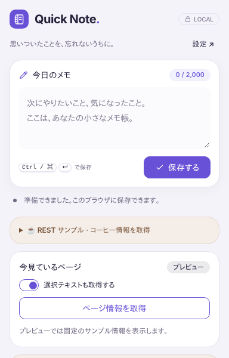 | 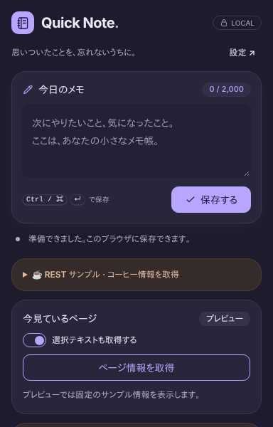 |
| サイドパネル | 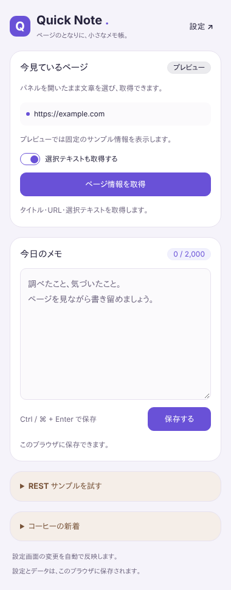 | 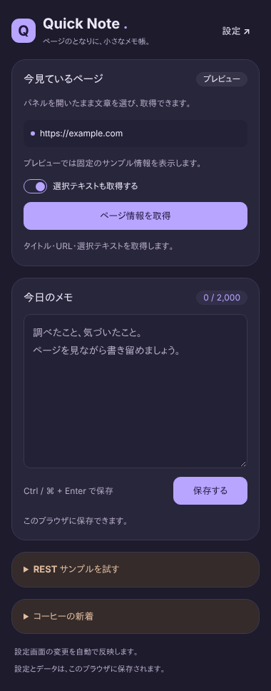 |
| 設定画面 |  | 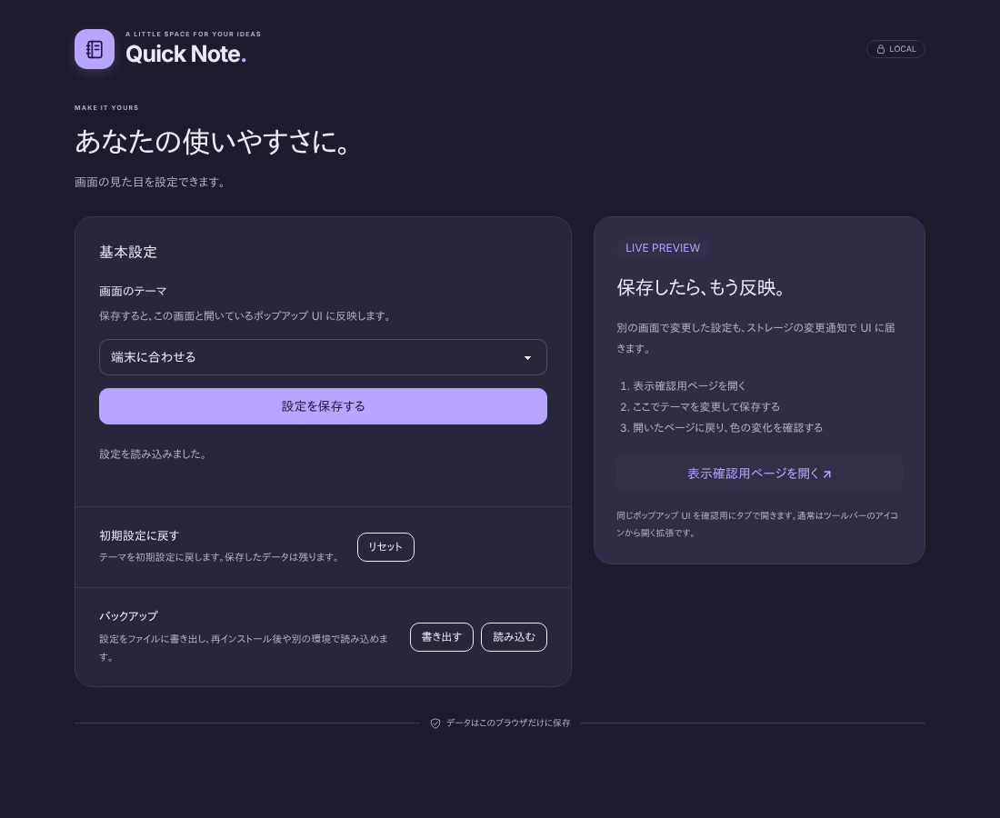 |
| 案内ページ | 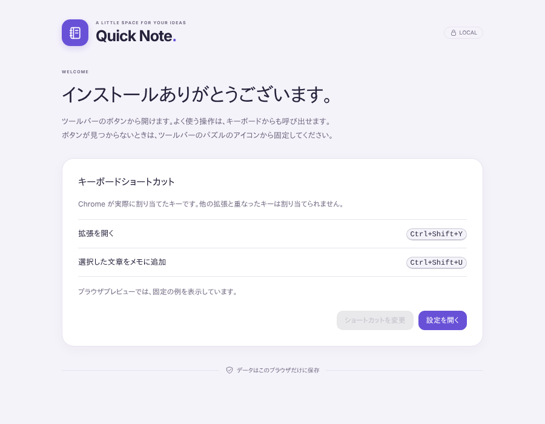 | 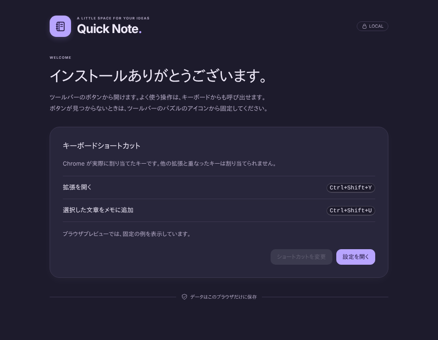 |

### コーヒー（`"palette": "coffee"`）

| 画面 | ライト | ダーク |
| --- | --- | --- |
| ポップアップ | 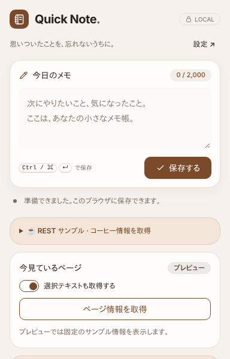 | 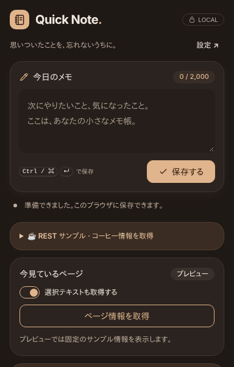 |
| サイドパネル | 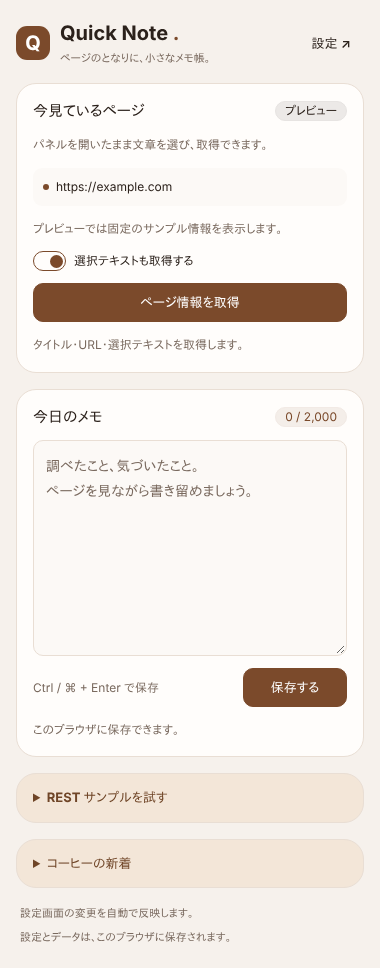 | 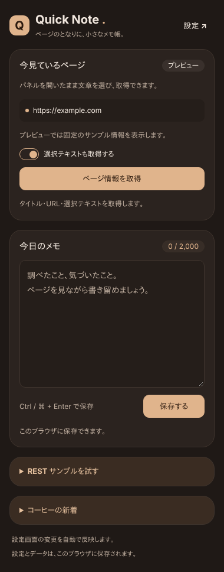 |
| 設定画面 | 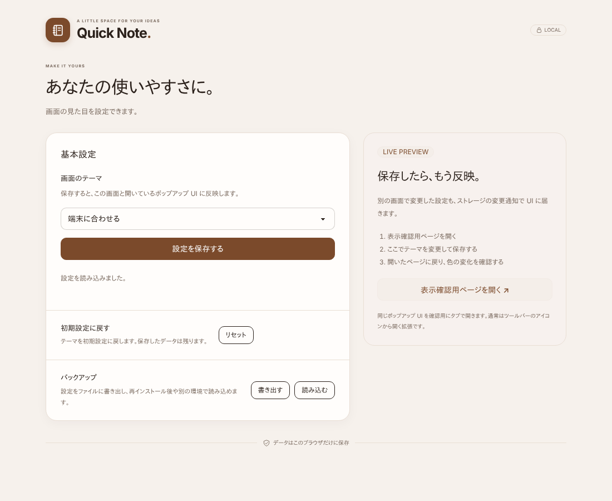 | 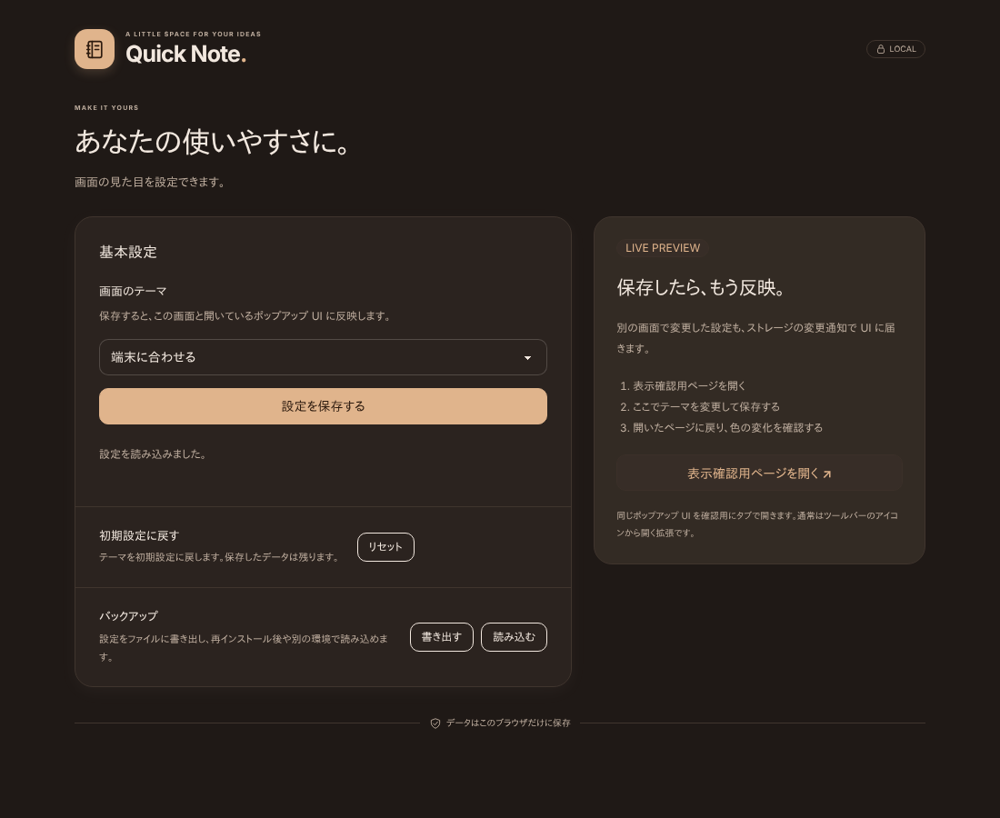 |
| 案内ページ | 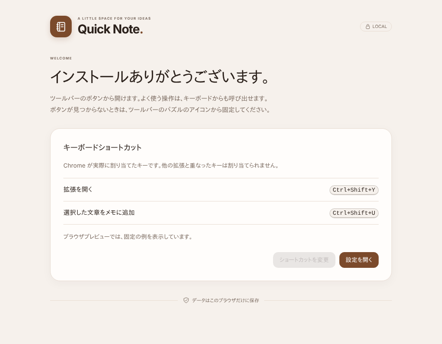 | 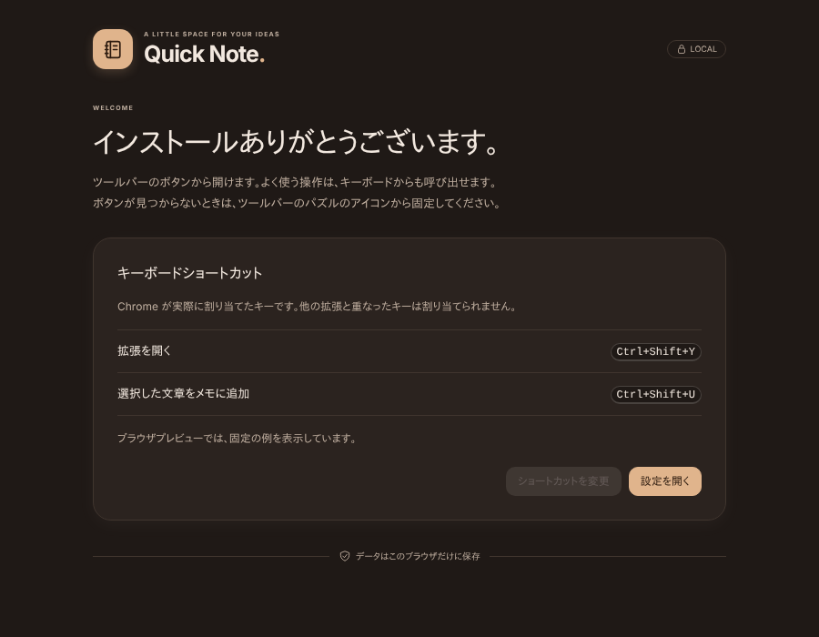 |

- サイドパネルはページを操作しながら使うため、縦長の画面に合わせています。
- 案内ページはブラウザプレビューのため、ショートカットは固定の例を表示しています。
- 上の画像は日本語の表示です。Chrome の表示言語が日本語以外のときは英語で表示します。
  英語表示の画像は各配色のフォルダーの `-en` のファイルです（例: [紫のポップアップ](docs/screenshots/purple/popup-light-en.png)、
  [コーヒーのポップアップ](docs/screenshots/coffee/popup-light-en.png)）。
- 画像はリポジトリに同梱しています（`docs/screenshots/<配色>/`）。[撮影条件](docs/screenshots/README.md)も参照してください。

## セットアップとコマンド

Node.js 26 LTS と pnpm 12.16.1 を使用します。`.nvmrc` は検証した 26.13.0 に固定しています。
nvm を導入済みの場合は、リポジトリのディレクトリで次を実行してください。

```sh
nvm install
nvm use
```

2026-11-04 時点の [Node.js 公式配布情報](https://nodejs.org/dist/index.json) で、
26.13.0 が最新安定版の LTS（Lithium）であることを確認しています。
Node.js と pnpm が導入済みの環境で、プロジェクトの依存関係をインストールして検証します。

```sh
pnpm install --frozen-lockfile
pnpm run check
```

検証済み環境: Node.js 26.13.0 / pnpm 12.16.1（2026-11-04）。
`pnpm install --frozen-lockfile`、共通基盤の契約テスト、型チェック、本番ビルド、配布物の構成テストで検証しています。

| コマンド | 内容 |
| --- | --- |
| `pnpm run dev` | UI プレビューと HMR |
| `pnpm run dev:sidepanel` | サイドパネル UI のプレビュー |
| `pnpm run dev:extension` | 拡張用の監視ビルド |
| `pnpm run dev:extension:sidepanel` | サイドパネル版の監視ビルド |
| `pnpm run typecheck` | ブラウザコード・テスト・ビルド設定の型チェック |
| `pnpm test` | 共通基盤の Input / Output 契約テスト（ビルド不要） |
| `pnpm run test:watch` | テストの監視実行 |
| `pnpm run build` / `pnpm run build:popup` | 型チェックと `dist/popup/` 生成 |
| `pnpm run build:sidepanel` | 型チェックと `dist/sidepanel/` 生成 |
| `pnpm run release` / `pnpm run release:sidepanel` | 公開用ビルド。ソースマップなしで `release/<方式>/` に出力し、配布物の確認後に `release/<name>-<方式>-<version>.zip` を作る |
| `pnpm run test:extension` | ビルド済みポップアップ版の構成確認 |
| `pnpm run test:extension:sidepanel` | ビルド済みサイドパネル版の構成確認 |
| `pnpm run check` | 契約テスト・型チェック・ビルド・配布物の構成確認 |
| `pnpm run check:sidepanel` | 同じ検証をサイドパネル版で実行 |
| `pnpm run test:e2e` | 両方式をビルドし、Chromium に拡張として読み込んで操作する E2E テスト（任意実行） |

<!-- @sample-begin -->
サンプル用のコマンドです。`pnpm run samples:remove` で一緒に削除されます。

| コマンド | 内容 |
| --- | --- |
| `pnpm run test:examples` | 開発者向けの参考テストを任意実行 |
| `pnpm run samples:remove` | サンプルを削除してベースだけにする |
| `pnpm run samples:verify` | 一時的な複製でサンプルを削除し、ベースの検証が通ることを確認する |
<!-- @sample-end -->

ベースのテストはサンプル固有の仕様を固定しません。メモ・設定・Coffee の項目や表示を
変更しても、共通基盤の契約を変えなければそのテストを書き換える必要はありません。
<!-- @sample-begin -->
`tests/examples/` の参考テストには、独自機能の開発時には参考にしてから削除する旨をコメントしています。
通常のテスト実行には含めませんが、型チェック対象のためサンプルの差し替え時に一緒に削除してください。
<!-- @sample-end -->
保証する範囲と派生プロジェクトでの追加方針は [テスト方針](docs/testing.md) を参照してください。

## パッケージ管理

`package.json` の `packageManager` で pnpm 12.16.1 を固定しています。
`pnpm-workspace.yaml` は単一パッケージの設定にも使用し、次の方針を共有します。

- `engineStrict: true`: Node.js 26 系の指定を必須にする。
- `saveExact: true`: 追加する直接依存のバージョンを固定する。
- `strictDepBuilds: true` / `allowBuilds: {}`: 未確認の依存スクリプトがあればインストールを失敗させる。現在の許可リストは空。

依存を追加する場合は `pnpm add <package>`、開発用なら `pnpm add -D <package>` を使います。
スクリプト付きの依存で停止したら、そのパッケージの処理を確認し、`allowBuilds` に判断を記録します。
必要なものだけ `true`、実行しないものは `false` とし、許可対象は可能ならバージョンも指定します。
設定例や詳細は [pnpm の build 設定](https://pnpm.io/settings/build) を参照してください。

更新時は `package.json`・`pnpm-lock.yaml`・必要な許可設定を一緒にレビューし、`pnpm run check` を実行します。
CI や取得直後の検証には `pnpm install --frozen-lockfile` を使います。
Node.js 26 と pnpm を準備済みのクラウド環境でも、セットアップコマンドは同じです。

<!-- @sample-begin -->
## サンプルを外してベースだけにする

メモ・ページ取得・サイト単位の許可はサンプルです。自分の機能を作り始めるときは、コミット後に次を実行します。

```sh
pnpm run samples:remove
pnpm run check
pnpm run check:sidepanel
```

テーマを切り替えられる空の画面、何も登録していない service worker、ベースのテストが残ります。
サンプル用の権限・文言・参考テストも一緒に削除します。CI はサンプルを消してもベースが壊れないことを毎回確認しています。
ベースとサンプルの分担と、サンプルの印の付け方は [サンプルのガイド](docs/samples.md) を参照してください。
<!-- @sample-end -->

## 確認用ビルドと公開用ビルド

| 用途 | コマンド | 出力 | ソースマップ |
| --- | --- | --- | --- |
| 開発・動作確認 | `pnpm run build` / `build:sidepanel` | `dist/<方式>/` | あり（調査用） |
| Chrome Web Store への提出 | `pnpm run release` / `release:sidepanel` | `release/<方式>/` と ZIP | なし |

公開用ビルドは、必須テスト・型チェックの後にビルドし、ソースマップが残っていないことと配布物の構成を確認してから ZIP にします。
ZIP は日時を固定して作るため、同じ内容なら同じファイルになります。ストアへのアップロードは手動です。

## 配色とビルド

配色はアプリの作成者が決めるもので、利用者は選びません。`package.json` の `palette` に書いた一つだけがビルドされます。

```json
"palette": "purple"
```

| 値 | 配色 |
| --- | --- |
| `purple` | 紫（既定。項目がないときもこれ） |
| `coffee` | コーヒー |

- 変えたら、いつもどおり `pnpm run build` / `build:sidepanel`、公開用は `pnpm run release` / `release:sidepanel` を実行します。
  コマンドに配色の指定はありません。どのビルドも `package.json` の値を使うため、CI でも同じ配色になります。
- 選ばなかった配色の CSS・色・アイコンは配布物に含まれません。`pnpm run check` の配布物テストが、選んだ配色だけが出力されていることを確認します。
- 存在しない名前を書くとビルドが止まり、選べる名前を表示します。
- 配色ごとのファイルは `src/palettes/<配色>/`（`theme.css`・`colors.ts`・`icons/`）にあります。
  配色の追加や中身の変更は [UI ガイド](docs/ui.md#配色を選ぶ)、アイコンの差し替えは [アイコンの差し替え](docs/icons.md) を参照してください。

## Actions から ZIP を取得

GitHub の **Actions → Extension CI** で成功した実行を開き、Artifacts の
`chrome-extension-popup-<コミット先頭12桁>.zip` をダウンロードできます。
ZIP を展開し、以下の Chrome 手順で `dist/popup/` の代わりに展開先フォルダーを選んでください。
手元でビルドせずに、サンプルを実際の拡張として確認できます。

PR・`master` 更新・`v*` タグ・手動実行で、必須テストからビルドまでを検証して ZIP を生成します。
既定はポップアップです。手動実行で `variant: sidepanel` を選ぶとサイドパネル版の ZIP を生成します。
操作方法と保存期間は [Actions ガイド](docs/ci.md) を参照してください。

## Chrome で実行

1. `pnpm run build` を実行する。
2. Chrome の `chrome://extensions` でデベロッパーモードを有効化する。
3. 「パッケージ化されていない拡張機能を読み込む」で `dist/popup/` を選ぶ。
4. 拡張をツールバーに固定し、ポップアップを開く。
5. メモを保存し、開き直して内容が残っていることを確認する。
6. 「REST サンプル」を開き、「サンプルを取得して保存」でメモの更新を確認する。取得と保存は service worker が行うため、
   直後にポップアップを閉じても保存まで完了する。
7. 通常の HTTP(S) ページで文章を選択し、拡張を開いて「ページ情報を取得」を押す。「選択テキストも取得する」で選択の取得を切り替えられる。
8. 「設定」からテーマを保存・リセットし、次に開いたポップアップへ反映されることを確認する。
9. 通常のページで文章を選んで右クリックし、「選択した文章をメモに追加」でメモの末尾に追加されることを確認する。
   ページの右下に結果の通知が出て、「元に戻す」で追加前に戻せる。追加できないときはそのタブのアイコンに `!` のバッジが付き、次の成功で消える。
10. 文章を選んで `Ctrl+Shift+U`（Mac は `⌘+Shift+U`）を押すと、右クリックと同じく末尾に追加される。
    `Ctrl+Shift+Y`（Mac は `⌘+Shift+Y`）で拡張を開く。キーは `chrome://extensions/shortcuts` で変更できる。
11. 設定画面の「書き出す」で設定を JSON ファイルに保存し、「読み込む」で戻せることを確認する。
12. 読み込んだ直後に案内ページ（`welcome.html`）が開き、割り当てられたショートカットが表示される。更新・再読み込みでは開かない。
13. 「コーヒーの新着」は 30 分ごとに確認され、増えた件数がアイコンのバッジに出る。開くと一覧を表示して既読になる。
    メモを保存して 60 分たつと、バッジに `●` が出て見直しを促す（画面を開くと消える）。
14. Chrome の表示言語を英語にすると、拡張名・画面・メニュー・ショートカットの説明が英語で表示される。

Chrome 124 以降に対応します。`pnpm run dev:extension` は変更時に再ビルドします。
変更後は拡張管理画面で再読み込みし、ポップアップを開き直してください。
同梱のアイコンは仮のものです。差し替える場所は [アイコンの差し替え](docs/icons.md) にあります。
ストアの説明・画像は製品に合わせて追加してください。

## 設定と UI の追従を試す

`pnpm run dev` の表示 URL で `/options.html` を開き、「表示確認用ページを開く」を押します。
設定画面でテーマを変更して保存すると、開いたページに戻った時には再読み込みなしで配色が変わります。
「リセット」には「初期設定に戻しますか？」という確認があり、確定すると初期値へ戻ります。メモは消えません。

本物のポップアップは別画面を操作すると閉じるため、比較用リンクは同じ UI をタブで開きます。
通常の起動方式はツールバーのポップアップです。

ページ取得は `activeTab` / `scripting` を使う拡張用ソースを実装済みです。
プレビューでは固定データを表示します。拡張として Chromium に読み込んだ確認では、実ページからの取得も確認しています。
ツールバーから開いた際の `activeTab` の付与は未検証です。
content script と service worker の役割、対応するページの範囲、動作確認手順は
[拡張サンプルのガイド](docs/extension.md) を参照してください。

## REST サンプル

「サンプルを取得して保存」は `GET https://api.sampleapis.com/coffee/hot/1` を呼びます。
API キーは不要です。起動時には呼ばず、ボタン操作で取得します。
レスポンスを検証し、タイトル・説明・材料をメモに変換して保存します。
現在のメモを置き換える操作です。取得や検証に失敗した場合は、保存済みのメモを維持します。

```ts
interface FetchCoffeeInput { id: number }
interface FetchCoffeeOutput {
  id: number;
  title: string;
  description: string;
  ingredients: string[];
  image: string;
}
```

`src/integrations/sampleapis/coffee.ts` に型・通信・外部データの検証があります。
`features/notes/gateways/coffee.ts` が外部の Coffee 形式をアプリの Note 形式へ変換し、
UseCase は「API 取得 → 保存 → 読み出し」のシーケンスを実行します。
`image` は受信データとして扱い、画像への追加通信はしません。

`public/manifest.json` に `https://api.sampleapis.com/*` の `host_permissions` を設定済みです。
クラウドからの実通信には環境設定でも `api.sampleapis.com` の許可が必要です。
API は公開サンプルでデータが変更される可能性があります。ベースの自動テストは外部 API を呼ばず、汎用 HTTP 処理を固定レスポンスで確認します。
通信エラーや一時的なサーバーエラーは自動で再試行し、それでも失敗したら「通信できない」「応答がない」「サービスが利用できない」
「データを読み取れない」を区別して表示します。HTTP の基盤の分担は [アーキテクチャガイド](docs/architecture.md#http-の分担) を参照してください。

## UI の開発

画面は SolidJS のコンポーネントで、状態は signal で管理します。Solid は `src/ui` の中だけで使い、
機能・composition・共通基盤はフレームワークに依存しません。
カード、ボタン、入力欄、ステータス表示、ローディング表示に daisyUI を使用します。
ライト／ダークのカスタムテーマと、OS に追従する設定を用意しています。
文字数表示と `Ctrl + Enter` / `⌘ + Enter` による保存にも対応しています。

`pnpm run dev` で UI をプレビューできます。プレビューでは `localStorage` を使い、
拡張では `chrome.storage.local` を使います。保存データは共有しません。
プレビューから実 API を呼ぶ場合は通常のブラウザの CORS 制約を受けます。
拡張の権限や CSP は、ビルドした `dist/popup/` または `dist/sidepanel/` を Chrome に読み込んで確認してください。

UI の責務分離とテーマの変更方法は [UI ガイド](docs/ui.md) を参照してください。
daisyUI に必須のフォルダー構成はなく、一般的な責務分離をこの拡張に合わせています。
CSS とアイコンはビルドに同梱し、外部 CDN やフォントサービスには依存しません。

## 構成

```text
src/
├── features/notes/
│   ├── note.ts             メモの型・制約
│   ├── ports.ts            公開操作・取得・保存の契約
│   ├── controllers/        load / save / import の入力検証と入口
│   ├── use-cases/          対応する load / save / import のシーケンス
│   ├── gateways/           メモの取得・変換・保存の実装
│   └── compose.ts          controller と UseCase を接続
├── features/settings/      設定の保存・リセット・変更通知（notes と同じ役割分け）
├── features/page/          現在のページ情報を取得（同じ役割分け。ページ内で動く関数は gateways/content.ts）
├── features/site-access/   サイドパネルのサイト確認・許可（同じ役割分け）
├── features/arrivals/      コーヒーの新着の定期確認（同じ役割分け）
├── features/welcome/       案内ページが表示するショートカット
├── content/                ページに注入する content script の入口（content/<名前>.js として出力）
├── palettes/               配色（purple / coffee）。package.json の palette で選んだ一つだけをビルド
├── background/             service worker の入口（方式ごと）と共通の登録処理
├── integrations/           サービスごとの型・client・境界検証
├── infrastructure/         共通の通信・保存・メッセージ・メニュー・ショートカット・アラーム・バッジ・ページ上の通知・多言語化の基盤
├── lib/validation.ts       検証の型と実行ラッパー
├── composition/            実行環境（environment.ts）と、機能・入口ごとの具体実装の選択
└── ui/
    ├── entrypoints/        起動点（Solid の render）
    ├── screens/            画面コンポーネント
    ├── layouts/            画面枠のコンポーネント
    ├── components/         表示部品のコンポーネント
    └── styles/             daisyUI / Tailwind の CSS エントリー
public/_locales/            ja / en の文言（chrome.i18n の messages.json）
tests/                      共通基盤の契約・配布物の構成テスト、任意の参考例、任意実行の E2E（tests/e2e）
scripts/                    公開用ビルドとサンプルの削除のスクリプト
```

controller は inbound adapter、gateway は outbound adapter に相当します。
機能内は役割で分け、操作の Input / Output 型はその操作が所有します。
小さな IF は `ports.ts` にまとめ、分類名だけの階層を重ねません。

入力検証は controller と一対一です。外部レスポンスや保存形式の検証はその境界で行います。
`lib/validation.ts` は検証を必須にする仕組みだけで、操作固有の検証条件は持ちません。
配置の理由と依存方向は [アーキテクチャガイド](docs/architecture.md) を参照してください。

保存 Input / 読み出し Output のバリデーターは両方必須です。片方だけでは初期化できません。
既存のメモ文字列は引き続き読み出せます。未保存は空メモ、破損データはエラーとして扱います。
API とストレージの実装は、機能ごとの `src/composition/notes.ts` / `page.ts` で差し替えられます。
入口ごとの `composition/popup.ts` / `sidepanel.ts` / `worker.ts` は、`composition/environment.ts` で実行環境（保存先・変更通知・ロック）を
1 回だけ作り、それを各機能の組み立てに渡して集めるだけです。

依存関係は `pnpm-lock.yaml` で固定しています。
バージョンは `package.json` の `version` だけで管理し、ビルドが manifest に書き込みます（`pnpm version patch` などで更新できます）。
Chrome の形式（0〜65535 の整数を 1〜4 個、`.` 区切り）でない値はビルドを止めます。
ページへの関数注入をサンプルに含めています。両方式の service worker は、メッセージの処理と右クリックメニューを登録します。
独自のバックグラウンド処理は、機能の composition でメッセージやメニュー項目を登録し、`composition/worker.ts` から呼んで追加します。
worker の制約と追加の手順は [service worker ガイド](docs/worker.md)、文言の追加は [多言語化ガイド](docs/i18n.md) を参照してください。

## Git

ローカルのメインブランチは `master`、このリポジトリの `user.name` は `codex-kun` です。
メールアドレスは設定していません。
作業は `codex-kun/<変更内容>` ブランチで行い、意味のある単位でコミットします。
検証後に `master` へ `--no-ff` でマージし、`master` と作業ブランチを push します。
詳しい作業ルールは [AGENTS.md](AGENTS.md) を参照してください。
