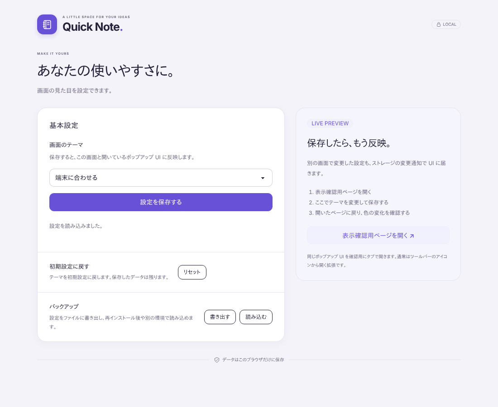
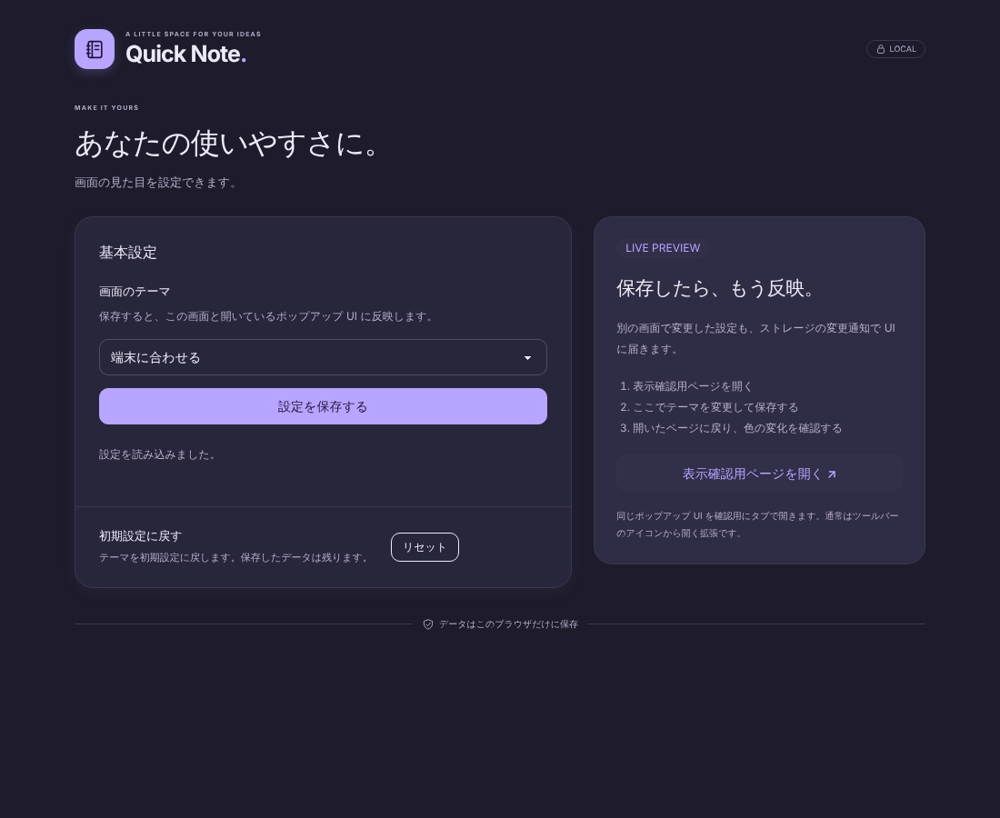

# Chrome Extension Base

UI フレームワークを使わない Manifest V3 の Chrome 拡張スターターです。
TypeScript + Vite + Vitest、素の HTML / DOM API と daisyUI 5 + Tailwind CSS 4 で構成しています。
メモの保存、[SampleAPIs](https://api.sampleapis.com/) の REST 取得、設定の保存・リセット、
現在のページ情報の取得、ストレージ変更への UI の追従を含みます。

## デザインのプレビュー

本番ビルドのポップアップ UI を Chromium で撮影したキャプチャーです。
テーマは設定画面で変更できます。初期設定では OS の表示設定に追従します。

| ライト | ダーク |
| --- | --- |
|  |  |

設定画面も daisyUI で構成しています。

| 設定画面・ライト | 設定画面・ダーク |
| --- | --- |
|  |  |

画像はリポジトリに同梱しています。[撮影条件](docs/screenshots/README.md)も参照してください。

## セットアップとコマンド

Node.js 26 LTS と pnpm 12.16.1 を使用します。`.nvmrc` は検証した 26.13.0 に固定しています。
nvm を導入済みの場合は、リポジトリのディレクトリで次を実行してください。

```sh
nvm install
nvm use
```

2026-10-31 時点の [Node.js 公式配布情報](https://nodejs.org/dist/index.json) で、
26.13.0 が最新安定版の LTS（Lithium）であることを確認しています。
Node.js と pnpm が導入済みの環境で、プロジェクトの依存関係をインストールして検証します。

```sh
pnpm install --frozen-lockfile
pnpm run check
```

検証済み環境: Node.js 26.13.0 / pnpm 12.16.1（2026-10-31）。
`pnpm install --frozen-lockfile`、共通基盤の契約テスト、型チェック、本番ビルド、配布物の構成テストで検証しています。

| コマンド | 内容 |
| --- | --- |
| `pnpm run dev` | UI プレビューと HMR |
| `pnpm run dev:extension` | 拡張用の監視ビルド |
| `pnpm run typecheck` | ブラウザコード・テスト・ビルド設定の型チェック |
| `pnpm test` | 共通基盤の Input / Output 契約テスト（ビルド不要） |
| `pnpm run test:watch` | テストの監視実行 |
| `pnpm run test:examples` | 開発者向けの参考テストを任意実行 |
| `pnpm run build` | 型チェックと `dist/` 生成 |
| `pnpm run test:extension` | ビルド済み `dist/` の構成確認（先に build が必要） |
| `pnpm run check` | 契約テスト・型チェック・ビルド・配布物の構成確認 |

ベースのテストはサンプル固有の仕様を固定しません。メモ・設定・Coffee の項目や表示を
変更しても、共通基盤の契約を変えなければそのテストを書き換える必要はありません。
`tests/examples/` の参考テストには、独自機能の開発時には参考にしてから削除する旨をコメントしています。
通常のテスト実行には含めませんが、型チェック対象のためサンプルの差し替え時に一緒に削除してください。
保証する範囲と派生プロジェクトでの追加方針は [テスト方針](docs/testing.md) を参照してください。

## パッケージ管理

`package.json` の `packageManager` で pnpm 12.16.1 を固定しています。
`pnpm-workspace.yaml` は単一パッケージの設定にも使用し、次の方針を共有します。

- `engineStrict: true`: Node.js 26 系の指定を必須にする。
- `saveExact: true`: 追加する直接依存のバージョンを固定する。
- `strictDepBuilds: true` / `allowBuilds: {}`: 未確認の依存スクリプトがあればインストールを失敗させる。現在の許可リストは空。

依存を追加する場合は `pnpm add <package>`、開発用なら `pnpm add -D <package>` を使います。
スクリプト付きの依存で停止したら、そのパッケージの処理を確認し、`allowBuilds` に判断を記録します。
必要なものだけ `true`、実行しないものは `false` とし、許可対象は可能ならバージョンも指定します。
設定例や詳細は [pnpm の build 設定](https://pnpm.io/settings/build) を参照してください。

更新時は `package.json`・`pnpm-lock.yaml`・必要な許可設定を一緒にレビューし、`pnpm run check` を実行します。
CI や取得直後の検証には `pnpm install --frozen-lockfile` を使います。
Node.js 26 と pnpm を準備済みのクラウド環境でも、セットアップコマンドは同じです。

## Actions から ZIP を取得

GitHub の **Actions → Extension CI** で成功した実行を開き、Artifacts の
`chrome-extension-<コミット先頭12桁>.zip` をダウンロードできます。
ZIP を展開し、以下の Chrome 手順で `dist/` の代わりに展開先フォルダーを選んでください。
手元でビルドせずに、サンプルを実際の拡張として確認できます。

PR・`master` 更新・`v*` タグ・手動実行で、必須テストからビルドまでを検証して ZIP を生成します。
操作方法と保存期間は [Actions ガイド](docs/ci.md) を参照してください。

## Chrome で実行

1. `pnpm run build` を実行する。
2. Chrome の `chrome://extensions` でデベロッパーモードを有効化する。
3. 「パッケージ化されていない拡張機能を読み込む」で `dist/` を選ぶ。
4. 拡張をツールバーに固定し、ポップアップを開く。
5. メモを保存し、開き直して内容が残っていることを確認する。
6. 「REST サンプル」を開き、「サンプルを取得して保存」でメモの更新を確認する。
7. 通常の HTTP(S) ページで文章を選択し、拡張を開いて「タイトル・URL・選択テキストを取得」を押す。
8. 「設定」からテーマを保存・リセットし、次に開いたポップアップへ反映されることを確認する。

Chrome 124 以降に対応します。`pnpm run dev:extension` は変更時に再ビルドします。
変更後は拡張管理画面で再読み込みし、ポップアップを開き直してください。
公開用アイコンやストアの説明・画像は製品に合わせて追加してください。

## 設定と UI の追従を試す

`pnpm run dev` の表示 URL で `/options.html` を開き、「表示確認用ページを開く」を押します。
設定画面でテーマを変更して保存すると、開いたページに戻った時には再読み込みなしで配色が変わります。
「リセット」には「初期設定に戻しますか？」という確認があり、確定すると初期値へ戻ります。メモは消えません。

本物のポップアップは別画面を操作すると閉じるため、比較用リンクは同じ UI をタブで開きます。
通常の起動方式はツールバーのポップアップです。

ページ取得は `activeTab` / `scripting` を使う拡張用ソースを実装済みです。
プレビューでは固定データを表示します。実際の拡張権限・注入はこの環境では未検証です。
content script と service worker の役割、対応するページの範囲、動作確認手順は
[拡張サンプルのガイド](docs/extension.md) を参照してください。

## REST サンプル

「サンプルを取得して保存」は `GET https://api.sampleapis.com/coffee/hot/1` を呼びます。
API キーは不要です。起動時には呼ばず、ボタン操作で取得します。
レスポンスを検証し、タイトル・説明・材料をメモに変換して保存します。
現在のメモを置き換える操作です。取得や検証に失敗した場合は、保存済みのメモを維持します。

```ts
interface FetchCoffeeInput { id: number }
interface FetchCoffeeOutput {
  id: number;
  title: string;
  description: string;
  ingredients: string[];
  image: string;
}
```

`src/integrations/sampleapis/coffee.ts` に型・通信・外部データの検証があります。
`features/notes/gateways/coffee.ts` が外部の Coffee 形式をアプリの Note 形式へ変換し、
UseCase は「API 取得 → 保存 → 読み出し」のシーケンスを実行します。
`image` は受信データとして扱い、画像への追加通信はしません。

`public/manifest.json` に `https://api.sampleapis.com/*` の `host_permissions` を設定済みです。
クラウドからの実通信には環境設定でも `api.sampleapis.com` の許可が必要です。
API は公開サンプルでデータが変更される可能性があります。ベースの自動テストは外部 API を呼ばず、汎用 HTTP 処理を固定レスポンスで確認します。

## UI の開発

カード、ボタン、入力欄、ステータス表示、ローディング表示に daisyUI を使用します。
ライト／ダークのカスタムテーマと、OS に追従する設定を用意しています。
文字数表示と `Ctrl + Enter` / `⌘ + Enter` による保存にも対応しています。

`pnpm run dev` で UI をプレビューできます。プレビューでは `localStorage` を使い、
拡張では `chrome.storage.local` を使います。保存データは共有しません。
プレビューから実 API を呼ぶ場合は通常のブラウザの CORS 制約を受けます。
拡張の権限や CSP は、ビルドした `dist/` を Chrome に読み込んで確認してください。

UI の責務分離とテーマの変更方法は [UI ガイド](docs/ui.md) を参照してください。
daisyUI に必須のフォルダー構成はなく、一般的な責務分離をこの拡張に合わせています。
CSS とアイコンはビルドに同梱し、外部 CDN やフォントサービスには依存しません。

## 構成

```text
src/
├── features/notes/
│   ├── note.ts             メモの型・制約
│   ├── ports.ts            公開操作・取得・保存の契約
│   ├── controllers/        load / save / import の入力検証と入口
│   ├── use-cases/          対応する load / save / import のシーケンス
│   ├── gateways/           メモの取得・変換・保存の実装
│   └── compose.ts          controller と UseCase を接続
├── features/settings/      設定の保存・リセット・変更通知（notes と同じ役割分け）
├── features/page/          現在のページ情報を取得（同じ役割分け）
├── content/                ページ内で実行する自己完結した関数
├── integrations/           サービスごとの型・client・境界検証
├── infrastructure/         共通の通信・保存基盤
├── lib/validation.ts       検証の型と実行ラッパー
├── composition/            環境に合わせた具体実装の選択
└── ui/
    ├── entrypoints/        起動点
    ├── screens/            画面
    ├── layouts/            画面枠
    ├── components/         表示部品
    └── styles/             daisyUI / Tailwind・テーマ
tests/                      共通基盤の契約・配布物の構成テストと任意の参考例
```

controller は inbound adapter、gateway は outbound adapter に相当します。
機能内は役割で分け、操作の Input / Output 型はその操作が所有します。
小さな IF は `ports.ts` にまとめ、分類名だけの階層を重ねません。

入力検証は controller と一対一です。外部レスポンスや保存形式の検証はその境界で行います。
`lib/validation.ts` は検証を必須にする仕組みだけで、操作固有の検証条件は持ちません。
配置の理由と依存方向は [アーキテクチャガイド](docs/architecture.md) を参照してください。

保存 Input / 読み出し Output のバリデーターは両方必須です。片方だけでは初期化できません。
既存のメモ文字列は引き続き読み出せます。未保存は空メモ、破損データはエラーとして扱います。
API とストレージの実装は `src/composition/popup.ts` で差し替えられます。

依存関係は `pnpm-lock.yaml` で固定しています。
バージョンを変更するときは `package.json` と `public/manifest.json` を揃えてください。
ページへの関数注入をサンプルに含めています。バックグラウンドのイベント処理が必要になったら、
service worker と対応するビルドエントリー・権限を追加してください。

## Git

ローカルのメインブランチは `master`、このリポジトリの `user.name` は `codex-kun` です。
メールアドレスは設定していません。
作業は `codex-kun/<変更内容>` ブランチで行い、意味のある単位でコミットします。
検証後に `master` へ `--no-ff` でマージし、`master` と作業ブランチを push します。
詳しい作業ルールは [AGENTS.md](AGENTS.md) を参照してください。
