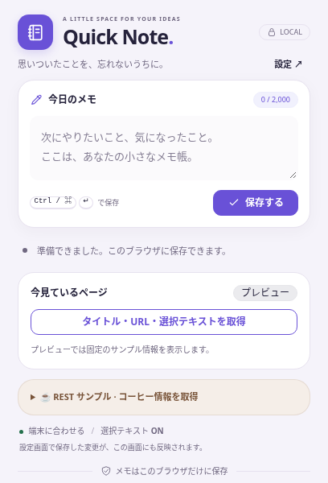
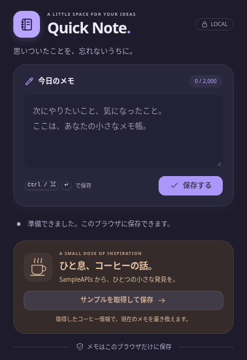

# Chrome Extension Base

UI フレームワークを使わない Manifest V3 の Chrome 拡張スターターです。
TypeScript + Vite + Vitest、素の HTML / DOM API と daisyUI 5 + Tailwind CSS 4 で構成しています。
メモの保存と、[SampleAPIs](https://api.sampleapis.com/) のコーヒー情報を取得して保存する例を含みます。

## デザインのプレビュー

本番ビルドのポップアップ UI を Chromium で撮影したキャプチャーです。
ライト／ダークは OS の表示設定に追従します。

| ライト | ダーク |
| --- | --- |
|  |  |

画像はリポジトリに同梱しています。[撮影条件](docs/screenshots/README.md)も参照してください。

## セットアップとコマンド

Node.js 24 と npm を使用します。nvm を使う場合は `nvm use`。

```sh
npm ci
npm run check
```

| コマンド | 内容 |
| --- | --- |
| `npm run dev` | UI プレビューと HMR |
| `npm run dev:extension` | 拡張用の監視ビルド |
| `npm run typecheck` | ブラウザコード・テスト・ビルド設定の型チェック |
| `npm test` | Vitest による Input / Output 契約テスト |
| `npm run test:watch` | テストの監視実行 |
| `npm run build` | 型チェックと `dist/` 生成 |
| `npm run check` | テスト・型チェック・ビルド |

## Chrome で実行

1. `npm run build` を実行する。
2. Chrome の `chrome://extensions` でデベロッパーモードを有効化する。
3. 「パッケージ化されていない拡張機能を読み込む」で `dist/` を選ぶ。
4. 拡張をツールバーに固定し、ポップアップを開く。
5. メモを保存し、開き直して内容が残っていることを確認する。
6. 「サンプルを取得して保存」でコーヒー情報がメモに入り、再度開いても残ることを確認する。

Chrome 124 以降に対応します。`npm run dev:extension` は変更時に再ビルドします。
変更後は拡張管理画面で再読み込みし、ポップアップを開き直してください。
公開用アイコンやストアの説明・画像は製品に合わせて追加してください。

## REST サンプル

「サンプルを取得して保存」は `GET https://api.sampleapis.com/coffee/hot/1` を呼びます。
API キーは不要です。起動時には呼ばず、ボタン操作で取得します。
レスポンスを検証し、タイトル・説明・材料をメモに変換して保存します。
現在のメモを置き換える操作です。取得や検証に失敗した場合は、保存済みのメモを維持します。

```ts
interface FetchCoffeeInput { id: number }
interface FetchCoffeeOutput {
  id: number;
  title: string;
  description: string;
  ingredients: string[];
  image: string;
}
```

`src/integrations/sampleapis/coffee.ts` に型・通信・外部データの検証があります。
`features/notes/gateways/coffee.ts` が外部の Coffee 形式をアプリの Note 形式へ変換し、
UseCase は「API 取得 → 保存 → 読み出し」のシーケンスを実行します。
`image` は受信データとして扱い、画像への追加通信はしません。

`public/manifest.json` に `https://api.sampleapis.com/*` の `host_permissions` を設定済みです。
クラウドからの実通信には環境設定でも `api.sampleapis.com` の許可が必要です。
API は公開サンプルでデータが変更される可能性があるため、テストは固定レスポンスで I/O を検証します。

## UI の開発

カード、ボタン、入力欄、ステータス表示、ローディング表示に daisyUI を使用します。
ライト／ダークのカスタムテーマは OS の設定に追従します。
文字数表示と `Ctrl + Enter` / `⌘ + Enter` による保存にも対応しています。

`npm run dev` で UI をプレビューできます。プレビューでは `localStorage` を使い、
拡張では `chrome.storage.local` を使います。保存データは共有しません。
プレビューから実 API を呼ぶ場合は通常のブラウザの CORS 制約を受けます。
拡張の権限や CSP は、ビルドした `dist/` を Chrome に読み込んで確認してください。

UI の責務分離とテーマの変更方法は [UI ガイド](docs/ui.md) を参照してください。
daisyUI に必須のフォルダー構成はなく、一般的な責務分離をこの拡張に合わせています。
CSS とアイコンはビルドに同梱し、外部 CDN やフォントサービスには依存しません。

## 構成

```text
src/
├── features/notes/
│   ├── note.ts             メモの型・制約
│   ├── ports.ts            公開操作・取得・保存の契約
│   ├── controllers/        load / save / import の入力検証と入口
│   ├── use-cases/          対応する load / save / import のシーケンス
│   ├── gateways/           メモの取得・変換・保存の実装
│   └── compose.ts          controller と UseCase を接続
├── integrations/           サービスごとの型・client・境界検証
├── infrastructure/         共通の通信・保存基盤
├── lib/validation.ts       検証の型と実行ラッパー
├── composition/            環境に合わせた具体実装の選択
└── ui/
    ├── entrypoints/        起動点
    ├── screens/            画面
    ├── layouts/            画面枠
    ├── components/         表示部品
    └── styles/             daisyUI / Tailwind・テーマ
tests/                      所有者ごとの入出力契約テスト
```

controller は inbound adapter、gateway は outbound adapter に相当します。
機能内は役割で分け、操作の Input / Output 型はその操作が所有します。
小さな IF は `ports.ts` にまとめ、分類名だけの階層を重ねません。

入力検証は controller と一対一です。外部レスポンスや保存形式の検証はその境界で行います。
`lib/validation.ts` は検証を必須にする仕組みだけで、操作固有の検証条件は持ちません。
配置の理由と依存方向は [アーキテクチャガイド](docs/architecture.md) を参照してください。

保存 Input / 読み出し Output のバリデーターは両方必須です。片方だけでは初期化できません。
既存のメモ文字列は引き続き読み出せます。未保存は空メモ、破損データはエラーとして扱います。
API とストレージの実装は `src/composition/popup.ts` で差し替えられます。

依存関係は `package-lock.json` で固定しています。
バージョンを変更するときは `package.json` と `public/manifest.json` を揃えてください。
バックグラウンド処理やページへの注入が必要になったら、service worker / content script と
対応するビルドエントリー・権限を追加してください。

## Git

ローカルのメインブランチは `master`、このリポジトリの `user.name` は `codex-kun` です。
メールアドレスは設定していません。
作業は `codex-kun/<変更内容>` ブランチで行い、意味のある単位でコミットします。
検証後に `master` へ `--no-ff` でマージし、`master` と作業ブランチを push します。
詳しい作業ルールは [AGENTS.md](AGENTS.md) を参照してください。
