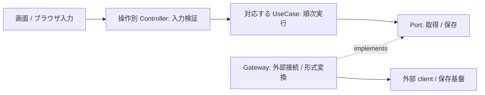

# アーキテクチャと境界

## ディレクトリを分ける基準

最初に所有者を分け、機能の中では役割を分けます。
同じ階層に業務名・技術名・依存方向を混ぜたり、分類名だけの階層を重ねたりしません。
ファイル名は親ディレクトリで分かる文脈を繰り返さず、その中で何を担当するかを表します。

```text
src/
├── features/notes/
│   ├── note.ts                メモの型と文字数制約
│   ├── ports.ts               公開操作・取得・保存の IF
│   ├── controllers/
│   │   ├── load.ts            読み出し入力の検証と入口
│   │   ├── save.ts            保存入力の検証と入口
│   │   ├── import.ts          取り込み入力の検証と入口
│   │   └── append.ts          追加入力の検証と入口（右クリックメニュー）
│   ├── use-cases/
│   │   ├── load.ts            読み出しのシーケンス
│   │   ├── save.ts            保存のシーケンス
│   │   ├── import.ts          取り込みのシーケンス
│   │   └── append.ts          追加のシーケンス
│   ├── gateways/
│   │   ├── storage.ts         メモの保存形式と Repository 実装
│   │   ├── coffee.ts          外部 Coffee をメモへ変換
│   │   ├── rest.ts            メモ形式の REST サービスとの接続
│   │   ├── worker.ts          取り込みを worker に依頼するメッセージと gateway
│   │   ├── failure.ts         取得の失敗を取り込みの理由に変換
│   │   └── mock.ts            取得元のモック
│   └── compose.ts             controller と UseCase の接続
├── features/settings/        設定操作・保存形式・変更通知（同じ役割分け）
├── features/page/            ページ取得（同じ役割分け。ページ内で動く関数は gateways/content.ts）
├── features/site-access/     サイト確認・許可（同じ役割分け）
├── background/               service worker の入口と、受信口・メニューの登録
├── integrations/sampleapis/
│   └── coffee.ts              Coffee 取得の型・通信・境界検証
├── infrastructure/
│   ├── http.ts                送信・時間切れ・中断・エラーの種類・再試行の仕組みと汎用の方針・JSON
│   └── storage/
│       ├── contracts.ts       driver IF と保存・読込の設定型
│       ├── typed.ts           型付き保存・読み出しの仕組み
│       └── drivers/
│           ├── chrome.ts      chrome.storage
│           ├── web.ts         localStorage
│           └── memory.ts      メモリ保存
│   ├── messaging/             worker とのメッセージ契約・router・client・Chrome の受信口
│   ├── context-menus.ts       右クリックメニューの作成とクリックの振り分け
│   └── i18n.ts                chrome.i18n とプレビュー用カタログの翻訳
├── lib/validation.ts          検証の型と実行ラッパー。操作の条件は持たない
├── composition/               実行環境（environment.ts）と、機能・入口・翻訳ごとの具体実装の選択
└── ui/                       起動点・画面・表示部品・スタイル
```

`features` は業務機能、`integrations` は外部サービス、`infrastructure` は技術基盤を所有します。
メモの controller / UseCase / gateway は、機能内の役割として横並びにします。
controller は inbound adapter、gateway は outbound adapter に相当します。
両者を総称する adapter という名前を、片方だけのディレクトリ名には使いません。

`ports.ts` はこの機能の小さな契約の集合です。数行の IF のために inbound / outbound の
階層を作りません。独立して大きくなる契約ができた時点で、責務ごとのファイルに分けます。
`NoteRepository` は保存キーや JSON を知らず、`NoteSource` は Coffee DTO や URL を知りません。
外部 API の型は integration、汎用の保存設定型は infrastructure に置きます。

`integrations/sampleapis/coffee.ts` は一つの外部操作に必要な型・検証・通信をまとめます。
同じ変更理由を持つ数十行を contracts / validation / client の三層に分散しません。
一方、汎用 HTTP とストレージ driver は機能から独立した責務なので分離を維持します。

## HTTP の分担

`infrastructure/http.ts` はどのサービスも知らない送信の仕組みです。

- `createHttpClient()` が送信・1 回ごとの時間切れ・`AbortSignal` による中断を扱います。
  応答が得られなければ `TransportError` を投げ、`kind` で `network`・`timeout`・`aborted` を区別します。
  応答が得られれば状態コードにかかわらず返します。`requestJson()` / `getJson()` は 2xx 以外を `HttpError`（`status` 付き）にします。
- 再試行は `RetryPolicy` で受け取る判断に従います。仕組みは「待つミリ秒か、やめるか」を聞くだけで、既定では再試行しません。
  `GET` と `HEAD` 以外は、方針を渡しても再試行しません。
- `createRetryPolicy()` は汎用の方針です。通信エラー・時間切れ・408/429/5xx を、間隔を倍にしながら再試行し、
  `Retry-After`（秒数または日時）があればそれに従います。回数・1 回の待ちの上限・合計時間の上限を持ちます。
  合計時間は、待ち時間に次の試行の時間切れまでを足しても上限に収まる場合だけ再試行する、という形で守ります。
- service worker は約 30 秒操作がないと停止し、通信や待ちの間は延長されません。worker で使う方針は、
  `maxElapsedMs` が 30 秒を十分に下回るように設定してください。`timeoutMs` が `maxElapsedMs` より長いと再試行しません。
- いつ・何回再試行するか、ページ送り（`Link` ヘッダーなど）、認証は、サービスごとに `integrations` が決めます。

失敗を画面に伝えるときは、gateway が `TransportError` / `HttpError` を機能の理由のコードに変換します。
worker とのメッセージでは、エラーの `reason` も呼び出し側に届くため、worker で起きた失敗も画面が文言を選べます。

## 入力検証は操作と一対一

「共通バリデーション層」を全操作が通る構成ではありません。
各 controller のファイルが、その操作の入力検証を持ち、検証後に対応する UseCase を呼びます。

| 操作 | 入力検証の所有者 | 検証後の処理 |
| --- | --- | --- |
| 読み出し | `controllers/load.ts`: 引数が undefined であること | `use-cases/load.ts` |
| 保存 | `controllers/save.ts`: メモ入力の構造・文字数 | `use-cases/save.ts` |
| 取り込み | `controllers/import.ts`: ID が正の安全な整数であること | `use-cases/import.ts` |
| 追加 | `controllers/append.ts`: 文章が文字列であること（空・文字数超過は追加の規則で理由付きの失敗） | `use-cases/append.ts` |
| 選択した文章の追加 | `controllers/append-selection.ts`: タブ ID が 0 以上の安全な整数であること | `use-cases/append-selection.ts` |
| 追加の取り消し | `controllers/undo-append.ts`: 引数が undefined であること | `use-cases/undo-append.ts` |
| 新着の確認・表示・既読 | `features/arrivals/controllers/*.ts`: 引数が undefined であること | `features/arrivals/use-cases/*.ts` |

各ファイルの非公開 `input` バリデーターを `validatedAction(input, execute)` に渡します。
UI が呼ぶ `NoteActions` は unknown を受け、UseCase は検証済みの Input 型を受けます。
操作固有の検証を保存 adapter や別の controller から再利用しません。
引数なしの操作にも専用の検証を置き、内容未定なら空の検証を明示します。

`lib/validation.ts` は `Validator` の型、`ValidationError`、検証を省略できない実行ラッパーだけです。
ID の条件や「引数なし」の規則を持たず、ブラウザイベントの共通検証も行いません。
DOM イベントは画面で扱い、取り出した値を操作ごとの controller に渡します。
worker とのメッセージは `MessageContract` の要求・応答バリデーターで構造を検証し、業務上の入力検証は受け側の controller に任せます。



## 検証ライブラリを使う場合

ベースとサンプルは依存を増やさないため、バリデーターを手書きしています。
派生製品で Valibot・Zod・ArkType などを使う場合は、`lib/validation.ts` の `fromStandardSchema()` で
そのスキーマを `Validator` に変換します。これらのライブラリが実装する [Standard Schema](https://standardschema.dev) の
共通インターフェイスに合わせているため、ベース側にライブラリ固有のコードはありません。

```ts
import * as v from "valibot";
import { fromStandardSchema, validatedAction } from "../../../lib/validation";

const input = fromStandardSchema(v.object({ text: v.pipe(v.string(), v.maxLength(MAX_NOTE_LENGTH)) }));
export const createSaveController = (execute: SaveNote) => validatedAction(input, execute);
```

- controller・保存の contract・メッセージの contract のどこでも、`Validator` の代わりに使えます。境界ごとに専用の検証を置く原則は同じです。
- 失敗は `ValidationError` になり、`issues` に各問題のメッセージと `path`（例: `["text"]`）が入ります。
- 検証は同期処理です。非同期の検証を含むスキーマは拒否します。
- ライブラリを足すと配布物が大きくなります。メモの入力程度の検証 1 つで、gzip 後に Valibot 約 1.6 kB、`zod/mini` 約 5.4 kB、
  Zod 約 25 kB、ArkType 約 51 kB 増えました（2026-11-04 の計測）。ArkType の型定義は `@types/node` を参照するため、
  `skipLibCheck` を有効にするか `@types/node` を型の対象に加える必要があります。

## 外部データと業務上の制約

UseCase 入力の検証と、外部から戻るデータの検証は別の境界です。

| 検証対象 | 所有者 |
| --- | --- |
| SampleAPIs へのリクエスト・レスポンス | `integrations/sampleapis/coffee.ts` の `parseRequest` / `parseResponse` / `parseList` |
| 別サービスから取得するメモ形式 | `features/notes/gateways/rest.ts` の `parseResponse` |
| 保存する値・保存済み文字列 | `features/notes/gateways/storage.ts`・`features/arrivals/gateways/storage.ts` の input / output |
| 共有のバッジの保存値 | `infrastructure/badge.ts` の `parseSlots`（壊れた枠だけを捨てる） |
| メモ本文は文字列かつ 2000 文字以内 | `features/notes/note.ts` の `noteText` |

`noteText` は共通の入力スキーマではなく、メモ自体の制約です。
手入力・API 変換後・保存からの復元という異なる経路でも同じ Note の条件を適用します。
各境界は自分が受け取る構造を検証し、本文の制約だけを再利用します。

## 依存方向と明示的 DI

- `note.ts` / `ports.ts` は controller・gateway・技術基盤に依存しない。
- UseCase はメモの型と port のみを参照し、controller・gateway を参照しない。
- controller は対応する UseCase の型とメモの制約・検証ラッパーを使う。
- gateway は port を実装し、必要な integration・infrastructure を使う。controller を参照しない。
- integration は機能を知らず、infrastructure は機能と外部サービスを知らない。
- UI の画面は `NoteActions` とメモの型・制約を使い、UseCase や具体 gateway を呼ばない。

`features/notes/compose.ts` は検証付き controller と UseCase を一対一で接続します。
`composition/notes.ts` は具体 gateway を選んでメモ機能を組み立て、画面用と worker 用の両方を提供します。
`composition/environment.ts` は実行環境を表します。拡張の中かブラウザプレビューかを判定し、保存先の driver・変更通知・
キーごとのロックを作ります。`composition/popup.ts` などの入口ごとの composition は、実行環境を 1 回だけ作って
各機能の組み立て（`composition/settings.ts`・`notes.ts`・`page.ts`）に渡し、結果を集めます。
`ui/entrypoints` がその結果を画面へ注入します。自動解決や DI コンテナーは使いません。

```ts
const coffeeClient = createSampleApisCoffeeClient((url, init) => globalThis.fetch(url, init));
return createNoteApplication({
  repository: createNoteStorage(driver),
  source: createSampleApisCoffeeSource(coffeeClient),
});
```

オフラインでは `source` を `createMockNoteSource([{ id: 1, text: "モックのメモ" }])` に差し替えます。

## UseCase はシーケンスを書く

`use-cases/import.ts` は取得 → 保存 → 読み出しの順に port を呼びます。

```ts
const note = await source.fetchNote(input);
await repository.save(note);
return repository.load();
```

通信・形式変換・入力検証・DOM 操作は外側の責務です。
シーケンシャルの規則は一回の実行内に適用し、途中の失敗は UI へ返します。
UI は双方向のイベントを扱えます。サンプルでは保存・取得中の操作を無効化します。
複数タブ間の排他やトランザクションは含みません。

## REST サンプル

`GET https://api.sampleapis.com/coffee/hot/{id}` を使います。
公開形式の参照先は [coffee.json](https://github.com/jermbo/SampleAPIs/blob/ef1f6b36076b28a39198b9b7654f9c734a78b83b/server/api/coffee.json)、
ルーティングは [jsonRouter.js](https://github.com/jermbo/SampleAPIs/blob/ef1f6b36076b28a39198b9b7654f9c734a78b83b/server/utils/jsonRouter.js) です。

ポップアップは ID 1 を取得し、タイトル・説明・材料をメモに変換して保存します。
画像 URL はデータとして検証するだけで追加取得・表示しません。
1 回の通信は 8 秒で時間切れにし、通信エラー・時間切れ・5xx などは間隔を広げて 2 回まで再試行します（時間切れも含めて合計 20 秒以内）。
失敗は gateway が `NoteImportError` の理由（`network`・`timeout`・`server`・`response`）に変換し、画面が文言を選びます。
取得や変換に失敗したら保存を開始しません。

`gateways/rest.ts` は別サービスの `GET {baseUrl}/notes/{id}` → `{ id, text }` 用です。
取得元を差し替えて使う例は、参考テストの `tests/examples/note-source.test.ts` にあります。
SampleAPIs に `/notes` があるという意味ではありません。
内部 port の引数は controller で検証済みの型を受けます。これらの gateway を UI の入口にはしません。

拡張の `host_permissions` は `https://api.sampleapis.com/*` に設定済みです。
プレビューでは CORS、クラウドではネットワーク許可が必要です。API キーは不要です。

## 保存 Input と読み出し Output の同時設定

`StorageContract<SaveInput, LoadOutput>` は input / output のバリデーターを両方必須にします。
片方だけでは型チェックでエラーとなり、実行時も初期化を拒否します。

保存は `input.parse → encode → output.parse → driver.set`、
読み出しは `driver.get → output.parse` の順です。書き込む前に読み出し可能な値かも検証します。
バリデーターは副作用を持たせません。Input と Output は異なる型でも構いません。

メモの保存キー・形式・未保存時の値は `gateways/storage.ts` 内の非公開 contract が所有します。
controller の保存入力スキーマは使いません。
Chrome / Web Storage / メモリの driver は get / set とキーごとのロックだけを実装し、メモを知りません。
既存の `quick-note` 文字列も読み出せます。プレビューの新データは名前空間付き JSON です。
未保存は空メモ、破損データはエラーとして扱います。

## 書き込みの直列化（save と update）

型付きストレージには書き込みが 2 つあります。

- `save(value)`：今の値に関係なく置き換える。設定の保存やリセットなど。
- `update(current => next)`：今の値から次の値を作って書く。追記・カウンター・一覧への追加など。

どちらもキーごとのロックを持ってから書くため、同じキーへの書き込みは互いに割り込みません。
たとえば「追記が読み出した後に別の画面が保存し、追記が古い値に足して書き戻す」ことは起きません。
読み出した値をもとに書くときは、`load` と `save` を続けて呼ばず、必ず `update` を使います。

ロックは driver に渡します。composition は Web Locks API（`createWebLocks(navigator.locks)`）を使い、
ポップアップ・サイドパネル・設定画面・service worker の間でも直列化します。同じ拡張の画面と worker は
オリジンが同じなので、同じ名前のロックを共有します。ロックを渡さない driver は、同じ実行環境の中だけで直列化します。

守れるのは型付きストレージを通した書き込み同士です。`chrome.storage` へ直接書く処理や、
別のキーにまたがる変更は対象外です。複数のキーを一度に変える必要があれば、1 つのキーにまとめて持つ設計にしてください。

## 追加・変更と確認

新しい操作は controller と UseCase を対にして追加します。
外部処理が必要なら port と gateway を追加し、compose で明示的に接続します。
検証処理を分割するほど大きくなった場合も、その操作の近くへ置き、検証全般の置き場には集めません。

必須の Vitest テストは共通基盤の入力に対する出力・エラー・保存後の値を確認します。
サンプル機能や SampleAPIs 固有の仕様は固定せず、共通 HTTP 処理には固定レスポンスを使います。
内部の呼び出し回数や詳細な順序、DOM スナップショットは検証しません。
`pnpm run check` で実行時の契約・型契約・本番ビルド・配布物の構成を確認します。
具体的な範囲は [テスト方針](testing.md) を参照してください。
<!-- @sample-begin -->
`tests/examples/` には、独自機能の開発時に参考にしてから削除する任意実行のテストを置いています。
<!-- @sample-end -->
UI の責務と daisyUI の設定は [UI ガイド](ui.md) を参照してください。

ディレクトリ名に唯一の標準はありません。ヘキサゴナルで必要な依存方向を守り、
この規模で責務を追える配置を選んでいます。

## 設定とページ取得の境界

`settings` と `page` も controller / UseCase / gateway を同じ深さに配置しています。
ベースの設定はテーマだけで、load / save / reset をそれぞれ専用の controller で検証します。
機能固有の設定は、その機能が所有します。ページ取得の「選択テキストも取得する」は `features/page` の
`CapturePreferences` で、専用の保存先と load / save の操作を持ちます。
ページ取得 UseCase は「取得の設定を読み出す → reader を呼ぶ」のシーケンスだけを持ちます。

`StorageChanges` は保存基盤の通知、`SettingsChanges` は検証済みの設定を UI に届ける port です。
通知の購読は UI に属し、UseCase の順次処理から独立しています。
UI は port と型に依存し、Chrome API や storage driver を直接扱いません。
ページ内の DOM アクセスは `features/page/gateways/content.ts` だけに閉じ込めます。これは Chrome gateway の
ページ側の半分で、`gateways/chrome.ts` が注入と応答の検証を担当します。

設定のリセット確認・変更通知の流れ・content script と service worker の説明は
[拡張サンプルのガイド](extension.md) にまとめています。

## サイドパネルの境界

`composition/sidepanel.ts` は設定と、`composition/notes.ts`・`composition/page.ts` の組み立てを集めます。
ポップアップの composition や画面を呼ばず、サイドパネルの UI へ port を注入します。
ページ取得対象はパネルを開いたウィンドウに固定し、そのウィンドウのアクティブタブを毎回取得します。

`features/site-access/` はサイトの確認・許可を所有します。status / grant の controller は
それぞれ専用の入力検証を持ち、UseCase は gateway 呼び出しのみを記述します。
gateway はタブ URL と Chrome の権限応答を検証し、タブ変更・権限変更を UI に通知します。
権限要求はクリックから同期的に Chrome API へ到達させ、その前に別の非同期処理を挟みません。
通知時の古い結果の破棄や再読み込みは UI の責務です。

ビルドの差分、UI の分離、権限の理由は [サイドパネルガイド](sidepanel.md) に記載しています。

## service worker の境界

worker は画面と同じ features を使う、もう一つの入口です。`composition/worker.ts` が router・共有のバッジと、メニュー・ショートカット・アラーム・インストール時の処理の一覧を作り、
各機能の composition（例: `composition/notes.ts` の `registerNoteWorker`）がメッセージの処理と項目を登録します。
`background/` はそれを最上位で受信口に接続するだけです。

- `infrastructure/messaging` と `context-menus.ts` は機能を知りません。メッセージの契約は処理を所有する機能の gateway が定義します。
- 画面からはメッセージを直接送らず、port を実装した gateway（例: `delegateImportToWorker`）を composition が注入します。
  画面は処理がその場で動くか worker で動くかを知りません。
- worker は `src/ui` を import しません。worker から静的に読み込むファイルに `src/ui`・Solid・動的 import がないことを、
  ビルド時に `vite.config.ts` の `worker-boundary` が確認します。
- worker には画面がないため、結果は `infrastructure/badge.ts`（ツールバーのバッジ）と `infrastructure/page-toast.ts`（ページ上の通知）で示します。
  どちらも文言と表示する条件を知らず、機能の composition が理由のコードから文言を選んで渡します。
- ショートカットは `infrastructure/commands.ts` が名前で振り分けます。キーと説明は manifest の `commands` に宣言します。
- アラーム（`alarms.ts`）とインストール時の処理（`lifecycle.ts`）も、機能が composition で項目を登録し、`background/` が最上位で接続します。
  「いつ予約し、いつ知らせ、いつ消すか」という規則は features の UseCase が持ち、アラームとバッジは port として受け取ります
  （例: `features/notes/use-cases/reminder.ts`。メモが空なら予約を取り消す、時刻が来てもメモが空なら知らせない）。
  composition はアラームの名前・バッジの枠と優先度・色を選んでつなぐだけで、判断を書きません。
  ストレージの変更通知やアラームの発火は、composition が UseCase の操作に渡します。
- 共有のバッジは機能ごとの枠を storage に保存し、優先度で表示を決めます。画面も同じ枠を消せます。
- content script（`src/content/`）は、ページの中で動くもう一つの入口です。worker と同じく `src/ui` に依存せず、
  機能の gateway（例: `requestUndoAppend`）を通して worker に処理を依頼します。保存や業務の判断はページ側で行いません。
- `NoteChanges` は `SettingsChanges` と同じく、保存基盤の通知を検証して UI に届ける port です。

制約と追加の手順は [service worker ガイド](worker.md) を参照してください。

<!-- @sample-begin -->
## ベースとサンプルの境界

ベースのコードは、サンプルを `@sample-begin` / `@sample-end` の印の中でだけ参照します。
画面の枠は機能の部品を子として受け取り、起動点が配置します。サンプルの機能は `composition/<機能>.ts` で組み立てます。
`pnpm run samples:verify` が、印とサンプルのファイルを消した状態でもビルドとテストが通ることを確認します。
詳細は [サンプルのガイド](samples.md) を参照してください。
<!-- @sample-end -->

## 文言の境界

画面に表示する文言は `public/_locales` にあり、UI が `useI18n()` で参照します。
features は文言を返さず、表示に必要な理由をコード（`PageCaptureError` の `reason` など）で返します。
`ValidationError` などの例外のメッセージは英語の開発者向けの診断で、ログや開発時の調査に使います。
画面は例外のメッセージを表示せず、理由のコードや失敗したという事実から自分の文言を選びます。
詳細は [多言語化ガイド](i18n.md) を参照してください。
