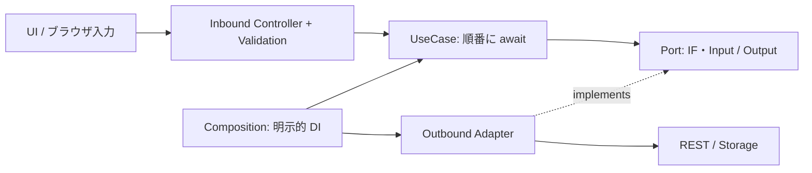

# ヘキサゴナルアーキテクチャの使い方

## ディレクトリの命名

ヘキサゴナルアーキテクチャは、特定のディレクトリ名を要求する規約ではありません。
TypeScript の公開実装でも構成は異なります。

| 実装例 | 確認した命名・説明 |
| --- | --- |
| [tim-hub/nestjs-hexagonal-example](https://github.com/tim-hub/nestjs-hexagonal-example#explanation-and-example-of-port-adapter) | Primary/Driving/Inbound と Secondary/Driven/Outbound を併記。ディレクトリは driving/driven |
| [Sairyss/domain-driven-hexagon](https://github.com/Sairyss/domain-driven-hexagon#interface-adapters) | interface-adapters を driving/primary、infrastructure の adapters を driven/secondary と説明 |
| [CodelyTV/typescript-ddd-example](https://github.com/CodelyTV/typescript-ddd-example/tree/master/src) | domain / application / infrastructure と apps 側の controllers を分離 |

上記は実装例であり、普及率を測った結果ではありません。
このプロジェクトでは役割が明確で既存構成とも合う **adapters/inbound / outbound** を採用します。
`input/output` も利用可能な表現ですが、ここでは Input/Output をデータ契約の型名に使います。

- **inbound / input / driving / primary**: 外部からアプリケーションの処理を起動する側。
- **outbound / output / driven / secondary**: アプリケーションから呼ばれる外部機能を実装する側。

これはデータが流れる方向ではなく、呼び出しを起動する側による区別です。
例えば `storage.load()` や REST の GET は、データを受け取る処理でも outbound です。

## 責務と依存方向

`domain` は型・制約を表し、ブラウザ API を参照しません。
`application/ports` は IF と入出力の型、`application/use-cases` は処理の順序を定義します。
UseCase は DOM・fetch・Chrome API・具体アダプターに依存しません。
`validation` が未知の値を検証し、`adapters/inbound` が各入口でその検証を必須にします。
`adapters/outbound` が外部処理を実装し、`composition` がポートと実装を手動で組み合わせます。
`ui/screens/popup` は controller だけを通して操作します。
UI 内は起動点・画面・レイアウト・表示部品・テーマに分けます。
daisyUI の詳細な構成は [UI ガイド](ui.md) を参照してください。



## UseCase はシーケンスを書く

`src/application/use-cases/import-note.ts` は次の順番に処理します。

```ts
const note = await api.fetchNote(input);
await storage.save(note);
return storage.load();
```

通信・形式変換・検証・DOM 操作は UseCase の外に置きます。
新しい処理は domain の関数や型付きポートへ切り出し、UseCase はその処理を順に呼びます。
途中で失敗した場合はエラーを UI へ返します。
シーケンシャルという規則は一回の UseCase 実行内に適用します。
UI は双方向のイベントを扱えます。サンプルでは保存・取得中の操作を無効化します。
複数のタブ間の排他やトランザクションは含みません。

## SampleAPIs の REST サンプル

`GET https://api.sampleapis.com/coffee/hot/{id}` を使います。
公開データとルーティングは以下の一次ソースで確認しています。

- [coffee.json](https://github.com/jermbo/SampleAPIs/blob/ef1f6b36076b28a39198b9b7654f9c734a78b83b/server/api/coffee.json)
- [jsonRouter.js](https://github.com/jermbo/SampleAPIs/blob/ef1f6b36076b28a39198b9b7654f9c734a78b83b/server/utils/jsonRouter.js)

| ファイル | 責務 |
| --- | --- |
| `application/ports/coffee-api.ts` | FetchCoffeeInput / Output と CoffeeApi |
| `validation/coffee-validation.ts` | ID とレスポンスの検証 |
| `adapters/outbound/http/sampleapis-coffee-api.ts` | URL の組み立てと REST 呼び出し |
| `adapters/outbound/http/http-client.ts` | GET・タイムアウト・HTTP エラー処理 |
| `adapters/outbound/http/coffee-note-api.ts` | Coffee を Note に変換 |
| `composition/popup.ts` | 実 API とストレージの DI |

ポップアップは ID 1 を取得し、タイトル・説明・材料をメモにして保存します。
レスポンス中の画像 URL はデータとして検証するだけで、画像の取得や表示は行いません。
API の不正データは `ValidationError`、HTTP エラーは `HttpError`（status 付き）で返します。
通信は 10 秒でタイムアウトします。取得・変換・検証に失敗した場合は保存を開始しません。

`host_permissions` は `https://api.sampleapis.com/*` を追加済みです。
プレビューでは API の CORS、クラウドではネットワーク許可も必要です。
認証情報や API キーは不要です。

## 軽量 DI とモックへの差し替え

`createApplication({ storage, api })` にポートを満たす実装を渡します。
自動解決やデコレーター、DI コンテナーは使いません。
実 API は `src/composition/popup.ts` で次のように接続します。

```ts
const coffeeApi = createSampleApisCoffeeApi((url, init) => globalThis.fetch(url, init));
return createApplication({
  storage: createTypedStorage(driver, noteStorageContract),
  api: createCoffeeNoteApi(coffeeApi),
});
```

オフライン開発では同じファイルで `api` を次の実装に差し替えられます。

```ts
import { createMockNoteApi } from "../adapters/outbound/mock/note-api";

// createApplication に渡す api プロパティ
api: createMockNoteApi([{ id: 1, text: "モックのメモ" }]),
```

汎用の `createNoteRestApi({ baseUrl, fetch })` も残しています。
これは `GET {baseUrl}/notes/{id}` → `{ id, text }` 用の別サービス向けテンプレートです。
SampleAPIs に `/notes` エンドポイントがあることを意味しません。

## 保存 Input と読み出し Output の同時設定

`StorageContract<SaveInput, LoadOutput>` には両方のバリデーターが必要です。

```ts
const contract: StorageContract<SaveNoteInput, LoadNoteOutput> = {
  key: "quick-note",
  input: saveNoteInput,       // unknown -> SaveNoteInput
  output: storedNoteOutput,  // 保存形式の unknown -> LoadNoteOutput
  encode: (input) => input.text,
};
const storage = createTypedStorage(driver, contract);
```

Input と Output は異なる型でも構いません。
`input` / `output` を一方だけ省くと型チェックでエラーになり、
JavaScript からの呼び出しでも初期化を拒否します。
保存は `input.parse → encode → output.parse → driver.set`、
読み出しは `driver.get → output.parse` の順です。
書き込む前に、その値が読み出しの契約にも適合していることを確認します。
バリデーターは副作用のない関数にしてください。

Chrome / Web Storage / メモリの driver を差し替えて同じ契約を使えます。
既存の `quick-note` 文字列は読めます。プレビューの新データは名前空間付きの JSON です。
未保存は空メモ、破損データはエラーにします。

## 入力は必ず検証する

controller は UseCase を `validatedAction(validator, execute)` で包みます。
公開操作は `unknown` を受け、検証済みの値だけを型付き UseCase に渡します。

```ts
loadNote: validatedAction(noInput, useCases.loadNote),
saveNote: validatedAction(saveNoteInput, useCases.saveNote),
importNote: validatedAction(fetchNoteInput, useCases.importNote),
```

引数のない操作にも `Validator<void>` を使い、`undefined` を渡します。
検証内容が未定なら `{ parse: (raw: unknown) => raw }` という空の実装でも、レイヤー自体は必須です。
将来追加する content script や `chrome.runtime.onMessage` も controller を入口にし、
UseCase や outbound adapter を直接呼ばないようにしてください。

## 機能追加とテスト

1. domain とポートの Input / Output を定義する。
2. outbound adapter に外部処理を実装する。保存処理には両方のバリデーターを設定する。
3. UseCase にシーケンスを書く。
4. 入力バリデーターを作り、inbound controller で UseCase を包む。
5. composition で実装を注入し、UI は controller を呼ぶ。
6. Vitest で入力に対する出力・エラー・保存後の読み出し結果を検証する。

テストは外部ネットワークを使わず、固定のレスポンスとメモリストレージで確認します。
内部の呼び出し回数、細かい呼び出し順序、DOM スナップショットには依存しません。
型契約は `expectTypeOf` と `@ts-expect-error` を含む型チェックで確認します。
`npm test` が実行時の契約、`npm run typecheck` が型契約、`npm run check` が両方とビルドです。
