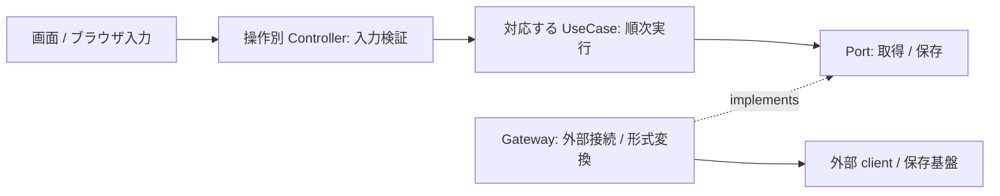

# アーキテクチャと境界

## ディレクトリを分ける基準

最初に所有者を分け、機能の中では役割を分けます。
同じ階層に業務名・技術名・依存方向を混ぜたり、分類名だけの階層を重ねたりしません。
ファイル名は親ディレクトリで分かる文脈を繰り返さず、その中で何を担当するかを表します。

```text
src/
├── features/notes/
│   ├── note.ts                メモの型と文字数制約
│   ├── ports.ts               公開操作・取得・保存の IF
│   ├── controllers/
│   │   ├── load.ts            読み出し入力の検証と入口
│   │   ├── save.ts            保存入力の検証と入口
│   │   └── import.ts          取り込み入力の検証と入口
│   ├── use-cases/
│   │   ├── load.ts            読み出しのシーケンス
│   │   ├── save.ts            保存のシーケンス
│   │   └── import.ts          取り込みのシーケンス
│   ├── gateways/
│   │   ├── storage.ts         メモの保存形式と Repository 実装
│   │   ├── coffee.ts          外部 Coffee をメモへ変換
│   │   ├── rest.ts            メモ形式の REST サービスとの接続
│   │   └── mock.ts            取得元のモック
│   └── compose.ts             controller と UseCase の接続
├── integrations/sampleapis/
│   └── coffee.ts              Coffee 取得の型・通信・境界検証
├── infrastructure/
│   ├── http.ts                GET・タイムアウト・HTTP エラー
│   └── storage/
│       ├── contracts.ts       driver IF と保存・読込の設定型
│       ├── typed.ts           型付き保存・読み出しの仕組み
│       └── drivers/
│           ├── chrome.ts      chrome.storage
│           ├── web.ts         localStorage
│           └── memory.ts      メモリ保存
├── lib/validation.ts          検証の型と実行ラッパー。操作の条件は持たない
├── composition/popup.ts       環境に合わせた具体実装の選択
└── ui/                       起動点・画面・表示部品・スタイル
```

`features` は業務機能、`integrations` は外部サービス、`infrastructure` は技術基盤を所有します。
メモの controller / UseCase / gateway は、機能内の役割として横並びにします。
controller は inbound adapter、gateway は outbound adapter に相当します。
両者を総称する adapter という名前を、片方だけのディレクトリ名には使いません。

`ports.ts` はこの機能の小さな契約の集合です。数行の IF のために inbound / outbound の
階層を作りません。独立して大きくなる契約ができた時点で、責務ごとのファイルに分けます。
`NoteRepository` は保存キーや JSON を知らず、`NoteSource` は Coffee DTO や URL を知りません。
外部 API の型は integration、汎用の保存設定型は infrastructure に置きます。

`integrations/sampleapis/coffee.ts` は一つの外部操作に必要な型・検証・通信をまとめます。
同じ変更理由を持つ数十行を contracts / validation / client の三層に分散しません。
一方、汎用 HTTP とストレージ driver は機能から独立した責務なので分離を維持します。

## 入力検証は操作と一対一

「共通バリデーション層」を全操作が通る構成ではありません。
各 controller のファイルが、その操作の入力検証を持ち、検証後に対応する UseCase を呼びます。

| 操作 | 入力検証の所有者 | 検証後の処理 |
| --- | --- | --- |
| 読み出し | `controllers/load.ts`: 引数が undefined であること | `use-cases/load.ts` |
| 保存 | `controllers/save.ts`: メモ入力の構造・文字数 | `use-cases/save.ts` |
| 取り込み | `controllers/import.ts`: ID が正の安全な整数であること | `use-cases/import.ts` |

各ファイルの非公開 `input` バリデーターを `validatedAction(input, execute)` に渡します。
UI が呼ぶ `NoteActions` は unknown を受け、UseCase は検証済みの Input 型を受けます。
操作固有の検証を保存 adapter や別の controller から再利用しません。
引数なしの操作にも専用の検証を置き、内容未定なら空の検証を明示します。

`lib/validation.ts` は `Validator` の型、`ValidationError`、検証を省略できない実行ラッパーだけです。
ID の条件や「引数なし」の規則を持たず、ブラウザイベントの共通検証も行いません。
DOM イベントは画面で扱い、取り出した値を操作ごとの controller に渡します。
将来、メッセージ形式などの共通プロトコル検証が必要になれば、その入口で定義します。



## 外部データと業務上の制約

UseCase 入力の検証と、外部から戻るデータの検証は別の境界です。

| 検証対象 | 所有者 |
| --- | --- |
| SampleAPIs へのリクエスト・レスポンス | `integrations/sampleapis/coffee.ts` の `parseRequest` / `parseResponse` |
| 別サービスから取得するメモ形式 | `features/notes/gateways/rest.ts` の `parseResponse` |
| 保存する値・保存済み文字列 | `features/notes/gateways/storage.ts` の input / output |
| メモ本文は文字列かつ 2000 文字以内 | `features/notes/note.ts` の `noteText` |

`noteText` は共通の入力スキーマではなく、メモ自体の制約です。
手入力・API 変換後・保存からの復元という異なる経路でも同じ Note の条件を適用します。
各境界は自分が受け取る構造を検証し、本文の制約だけを再利用します。

## 依存方向と明示的 DI

- `note.ts` / `ports.ts` は controller・gateway・技術基盤に依存しない。
- UseCase はメモの型と port のみを参照し、controller・gateway を参照しない。
- controller は対応する UseCase の型とメモの制約・検証ラッパーを使う。
- gateway は port を実装し、必要な integration・infrastructure を使う。controller を参照しない。
- integration は機能を知らず、infrastructure は機能と外部サービスを知らない。
- UI の画面は `NoteActions` とメモの型・制約を使い、UseCase や具体 gateway を呼ばない。

`features/notes/compose.ts` は検証付き controller と UseCase を一対一で接続します。
`composition/popup.ts` は環境に応じた driver と具体 gateway を作ります。
`ui/entrypoints` がその結果を画面へ注入します。自動解決や DI コンテナーは使いません。

```ts
const coffeeClient = createSampleApisCoffeeClient((url, init) => globalThis.fetch(url, init));
return createNoteApplication({
  repository: createNoteStorage(driver),
  source: createSampleApisCoffeeSource(coffeeClient),
});
```

オフラインでは `source` を `createMockNoteSource([{ id: 1, text: "モックのメモ" }])` に差し替えます。

## UseCase はシーケンスを書く

`use-cases/import.ts` は取得 → 保存 → 読み出しの順に port を呼びます。

```ts
const note = await source.fetchNote(input);
await repository.save(note);
return repository.load();
```

通信・形式変換・入力検証・DOM 操作は外側の責務です。
シーケンシャルの規則は一回の実行内に適用し、途中の失敗は UI へ返します。
UI は双方向のイベントを扱えます。サンプルでは保存・取得中の操作を無効化します。
複数タブ間の排他やトランザクションは含みません。

## REST サンプル

`GET https://api.sampleapis.com/coffee/hot/{id}` を使います。
公開形式の参照先は [coffee.json](https://github.com/jermbo/SampleAPIs/blob/ef1f6b36076b28a39198b9b7654f9c734a78b83b/server/api/coffee.json)、
ルーティングは [jsonRouter.js](https://github.com/jermbo/SampleAPIs/blob/ef1f6b36076b28a39198b9b7654f9c734a78b83b/server/utils/jsonRouter.js) です。

ポップアップは ID 1 を取得し、タイトル・説明・材料をメモに変換して保存します。
画像 URL はデータとして検証するだけで追加取得・表示しません。
HTTP エラーは status 付きの `HttpError`、不正データは `ValidationError` を返し、通信は 10 秒でタイムアウトします。
取得や変換に失敗したら保存を開始しません。

`gateways/rest.ts` は別サービスの `GET {baseUrl}/notes/{id}` → `{ id, text }` 用です。
SampleAPIs に `/notes` があるという意味ではありません。
内部 port の引数は controller で検証済みの型を受けます。これらの gateway を UI の入口にはしません。

拡張の `host_permissions` は `https://api.sampleapis.com/*` に設定済みです。
プレビューでは CORS、クラウドではネットワーク許可が必要です。API キーは不要です。

## 保存 Input と読み出し Output の同時設定

`StorageContract<SaveInput, LoadOutput>` は input / output のバリデーターを両方必須にします。
片方だけでは型チェックでエラーとなり、実行時も初期化を拒否します。

保存は `input.parse → encode → output.parse → driver.set`、
読み出しは `driver.get → output.parse` の順です。書き込む前に読み出し可能な値かも検証します。
バリデーターは副作用を持たせません。Input と Output は異なる型でも構いません。

メモの保存キー・形式・未保存時の値は `gateways/storage.ts` 内の非公開 contract が所有します。
controller の保存入力スキーマは使いません。
Chrome / Web Storage / メモリの driver は get / set だけを実装し、メモを知りません。
既存の `quick-note` 文字列も読み出せます。プレビューの新データは名前空間付き JSON です。
未保存は空メモ、破損データはエラーとして扱います。

## 追加・変更と確認

新しい操作は controller と UseCase を対にして追加します。
外部処理が必要なら port と gateway を追加し、compose で明示的に接続します。
検証処理を分割するほど大きくなった場合も、その操作の近くへ置き、検証全般の置き場には集めません。

Vitest は入力に対する出力・エラー・保存後の値を確認します。
外部通信は固定レスポンスを使い、内部の呼び出し回数や詳細な順序、DOM スナップショットは検証しません。
`pnpm run check` で実行時の契約・型契約・本番ビルドを確認します。
UI の責務と daisyUI の設定は [UI ガイド](ui.md) を参照してください。

ディレクトリ名に唯一の標準はありません。ヘキサゴナルで必要な依存方向を守り、
この規模で責務を追える配置を選んでいます。
