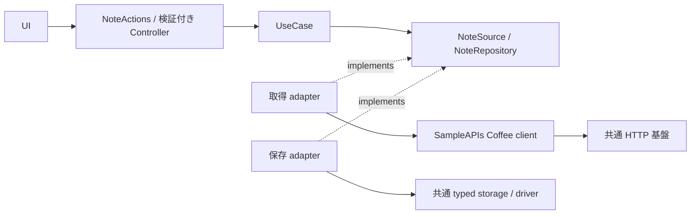

# ヘキサゴナルアーキテクチャの使い方

## ディレクトリの命名

ヘキサゴナルアーキテクチャは、特定のディレクトリ名を要求する規約ではありません。
TypeScript の公開実装でも構成は異なります。

| 実装例 | 確認した命名・説明 |
| --- | --- |
| [tim-hub/nestjs-hexagonal-example](https://github.com/tim-hub/nestjs-hexagonal-example#explanation-and-example-of-port-adapter) | Primary/Driving/Inbound と Secondary/Driven/Outbound を併記。ディレクトリは driving/driven |
| [Sairyss/domain-driven-hexagon](https://github.com/Sairyss/domain-driven-hexagon#interface-adapters) | interface-adapters を driving/primary、infrastructure の adapters を driven/secondary と説明 |
| [CodelyTV/typescript-ddd-example](https://github.com/CodelyTV/typescript-ddd-example/tree/master/src) | domain / application / infrastructure と apps 側の controllers を分離 |

上記は実装例であり、普及率を測った結果ではありません。
このプロジェクトでは役割が明確で既存構成とも合う **adapters/inbound / outbound** を採用します。
`input/output` も利用可能な表現ですが、ここでは Input/Output をデータ契約の型名に使います。

- **inbound / input / driving / primary**: 外部からアプリケーションの処理を起動する側。
- **outbound / output / driven / secondary**: アプリケーションから呼ばれる外部機能を実装する側。

これはデータが流れる方向ではなく、呼び出しを起動する側による区別です。
例えば `storage.load()` や REST の GET は、データを受け取る処理でも outbound です。

## 責務の所有者で分ける

まず「どの機能・外部サービス・技術基盤に属するか」を分け、その中で依存方向を分けます。
`http-client` は汎用的ですが、業務に対しては低水準の通信実装です。
汎用性と業務上の抽象度は別の軸です。同じ通信経路で使うという理由だけでは、
HTTP 処理・Coffee DTO・Coffee → Note 変換を同じフォルダーへ置きません。

```text
src/
├── features/notes/                     メモ機能のヘキサゴン
│   ├── domain/note.ts                  メモの型・文字数制約
│   ├── application/
│   │   ├── contracts.ts               メモ操作の Input / Output
│   │   ├── ports/
│   │   │   ├── inbound/note-actions.ts 公開操作の IF
│   │   │   └── outbound/
│   │   │       ├── note-source.ts     メモを取得する IF
│   │   │       └── note-repository.ts  メモを保存・読み出す IF
│   │   └── use-cases/                 検証済み入力で順次実行
│   ├── validation/                    メモ操作・メモ形式の検証
│   ├── adapters/
│   │   ├── inbound/note-controller.ts  公開操作の検証境界
│   │   └── outbound/
│   │       ├── sources/               REST / Coffee 変換 / モック
│   │       └── persistence/           保存キー・保存形式・Repository 実装
│   └── compose.ts                     機能内の UseCase と入口を接続
├── integrations/sampleapis/coffee/
│   ├── contracts.ts                   外部サービスの Input / Output / Client IF
│   ├── validation.ts                  外部サービスのデータ形式を検証
│   └── client.ts                      URL・リクエスト・レスポンス処理
├── infrastructure/
│   ├── http/http-client.ts            共通 GET・タイムアウト・HTTP エラー
│   └── storage/
│       ├── key-value-storage.ts       driver が実装する get / set の IF
│       ├── storage-contract.ts        保存・読込の検証と codec 設定
│       ├── typed-storage.ts           検証を伴う汎用の保存・読み出し
│       └── drivers/                   Chrome / Web Storage / メモリ
├── shared/validation/                 Validator・基本検証・検証付き action
├── composition/popup.ts               ブラウザ環境と具体実装を選ぶ DI
└── ui/                                起動点・画面・共通の表示部品
```

`ports` は「IF なら何でも置く場所」ではありません。UseCase が要求するメモの操作を
application が所有します。`KeyValueStorage` は技術基盤の拡張点、`CoffeeClient` は
外部サービスのクライアント契約なので、それぞれの所有者の近くに置きます。
`NoteRepository` は保存キー・JSON・ブラウザ API・汎用 codec を知りません。
`NoteSource` は Coffee の title / ingredients や REST の URL を知りません。

## 依存方向

以下は import の方向です。同じ所有者・同じ層の内部参照は省略しています。

| 所有者 | 参照してよい相手 | 参照しない相手 |
| --- | --- | --- |
| `shared/validation` | 標準言語機能 | features・integrations・infrastructure・UI |
| `infrastructure` | shared | features・integrations・UI |
| `integrations` | infrastructure・shared | features・UI |
| 機能の `domain` | 標準言語機能 | application・adapters・技術基盤 |
| 機能の `application` | 自機能の domain | adapters・validation・integrations・infrastructure・UI |
| 機能の `validation` | 自機能の domain / application、shared | adapters・integrations・技術基盤 |
| 機能の `adapters/inbound` | 自機能の application / validation、shared | outbound・外部サービス・技術基盤 |
| 機能の `adapters/outbound` | 自機能の application / validation、integrations・infrastructure・shared | inbound・UI |
| `ui/screens` | 機能の公開 inbound port / domain、UI 部品 | 具体 adapter・UseCase・技術基盤 |
| `ui/components` / `layouts` | 表示に必要な UI 部品 | 機能の操作・技術基盤 |

`features/notes/compose.ts` は注入済みの port と UseCase・controller を接続します。
`composition/popup.ts` は Chrome / Web Storage を選び、具体 adapter と外部 client を作ります。
`ui/entrypoints` がその結果を画面に渡します。DI コンテナーや自動解決は使いません。



UI の固定マークアップ・DOM 状態は画面の責務です。画面固有の部品を無理に共有化せず、
共通のボタン・フィードバック・画面枠だけを共有しています。
daisyUI の構成は [UI ガイド](ui.md) を参照してください。

## UseCase はシーケンスを書く

`src/features/notes/application/use-cases/import-note.ts` は次の順番に処理します。

```ts
const note = await source.fetchNote(input);
await repository.save(note);
return repository.load();
```

通信・形式変換・検証・DOM 操作は UseCase の外に置きます。
途中で失敗した場合はエラーを UI へ返します。
シーケンシャルという規則は一回の UseCase 実行内に適用します。
UI は双方向のイベントを扱えます。サンプルでは保存・取得中の操作を無効化します。
複数のタブ間の排他やトランザクションは含みません。

## SampleAPIs の REST サンプル

`GET https://api.sampleapis.com/coffee/hot/{id}` を使います。
公開データとルーティングは以下の一次ソースで確認しています。

- [coffee.json](https://github.com/jermbo/SampleAPIs/blob/ef1f6b36076b28a39198b9b7654f9c734a78b83b/server/api/coffee.json)
- [jsonRouter.js](https://github.com/jermbo/SampleAPIs/blob/ef1f6b36076b28a39198b9b7654f9c734a78b83b/server/utils/jsonRouter.js)

`integrations/sampleapis/coffee` は SampleAPIs の形式だけを扱い、メモの文字数制約を知りません。
`features/notes/adapters/outbound/sources/sampleapis-coffee-source.ts` が
Coffee をメモに変換し、メモの出力契約を検証します。
HTTP 処理自体をしないので、`http/coffee-note-api.ts` という配置・名前は使いません。

ポップアップは ID 1 を取得し、タイトル・説明・材料をメモにして保存します。
画像 URL はデータとして検証するだけで、画像の取得・表示は行いません。
不正データは `ValidationError`、HTTP エラーは `HttpError`（status 付き）で返します。
通信は 10 秒でタイムアウトします。取得・変換・検証に失敗した場合は保存を開始しません。

`host_permissions` は `https://api.sampleapis.com/*` を追加済みです。
プレビューでは API の CORS、クラウドではネットワーク許可も必要です。
認証情報や API キーは不要です。

## 軽量 DI とモックへの差し替え

`createNoteApplication({ repository, source })` にポートを満たす実装を渡します。
実 API は `src/composition/popup.ts` で次のように接続します。

```ts
const coffeeClient = createSampleApisCoffeeClient((url, init) => globalThis.fetch(url, init));
return createNoteApplication({
  repository: createNoteStorage(driver),
  source: createSampleApisCoffeeSource(coffeeClient),
});
```

オフライン開発では `source` を次の実装に差し替えられます。

```ts
import { createMockNoteSource } from "../features/notes/adapters/outbound/sources/mock-note-source";

// createNoteApplication に渡す source プロパティ
source: createMockNoteSource([{ id: 1, text: "モックのメモ" }]),
```

`createRestNoteSource({ baseUrl, fetch })` は
`GET {baseUrl}/notes/{id}` → `{ id, text }` 用の別サービス向けテンプレートです。
メモ形式に依存するため、汎用 HTTP 基盤ではなくメモ機能の取得 adapter に置いています。
SampleAPIs に `/notes` エンドポイントがあることを意味しません。

## 保存 Input と読み出し Output の同時設定

`infrastructure/storage` の `StorageContract<SaveInput, LoadOutput>` は
両方のバリデーターを必須にします。`TypedStorage` は任意の型に使える技術基盤の IF で、
application の `NoteRepository` に依存しません。
メモ固有の `note-storage-contract.ts` が保存キー・文字列形式・未保存時の値を定義し、
`createNoteStorage(driver)` がこの設定を適用して `NoteRepository` を返します。

```ts
const contract: StorageContract<SaveNoteInput, LoadNoteOutput> = {
  key: "quick-note",
  input: saveNoteInput,
  output: { parse(raw) { return { text: raw === undefined ? "" : noteText(raw) }; } },
  encode: (input) => input.text,
};
const storage = createTypedStorage(driver, contract);
```

Input と Output は異なる型でも構いません。
`input` / `output` を一方だけ省くと型チェックでエラーになり、
JavaScript からの呼び出しでも初期化を拒否します。
保存は `input.parse → encode → output.parse → driver.set`、
読み出しは `driver.get → output.parse` の順です。
書き込む前に、その値が読み出しの契約にも適合していることを確認します。
バリデーターは副作用のない関数にしてください。

driver は get / set だけを実装し、「何を保存するか」は知りません。
Chrome / Web Storage / メモリを差し替えて同じメモ保存契約を使えます。
既存の `quick-note` 文字列は読めます。プレビューの新データは名前空間付きの JSON です。
未保存は空メモ、破損データはエラーにします。

## 入力は必ず検証する

公開 inbound port `NoteActions` は未知の値を受け取ります。
その実装である controller が `validatedAction(validator, execute)` を必ず使い、
検証済みの値だけを内部の型付き `NoteUseCases` に渡します。
UI は `NoteActions` に依存し、controller の具体型や UseCase を import しません。

```ts
loadNote: validatedAction(noInput, useCases.loadNote),
saveNote: validatedAction(saveNoteInput, useCases.saveNote),
importNote: validatedAction(importNoteInput, useCases.importNote),
```

引数のない操作にも `Validator<void>` を使い、`undefined` を渡します。
検証内容が未定でも `{ parse: (raw: unknown) => raw }` のようにレイヤーを明示します。
将来追加する content script や `chrome.runtime.onMessage` も検証付き公開操作を入口にしてください。

基本的なオブジェクト・ID 検証は `shared/validation`、メモの操作検証は機能内の `validation`、
Coffee DTO の検証は integration、保存形式の検証は persistence adapter が所有します。
共有バリデーションや外部サービスが、メモ用の検証モジュールへ依存しない構成です。

## 機能追加とテスト

1. 新しい機能は `features/<機能名>` に domain・application の契約と port を定義する。
2. 機能固有の外部処理はその機能の outbound adapter に置く。
3. 外部サービスの DTO・client は `integrations/<サービス>/<リソース>`、機能を知らない技術処理は `infrastructure` に置く。
4. UseCase にシーケンスを書き、inbound controller で検証を必須にする。
5. composition で実装を注入し、画面は公開 inbound port を呼ぶ。
6. Vitest で入力に対する出力・エラー・保存後の読み出し結果を検証する。

`tests/features/notes` はメモ操作と保存互換性、`tests/integrations` は外部 client、
`tests/infrastructure` は機能に依存しない保存契約、`tests/shared` は検証境界を確認します。
外部ネットワークを使わず、固定のレスポンスとメモリストレージを使います。
内部の呼び出し回数、細かい順序、DOM スナップショットには依存しません。
型契約は `expectTypeOf` と `@ts-expect-error` を含む型チェックで確認します。
`npm test` が実行時の契約、`npm run typecheck` が型契約、`npm run check` が両方とビルドです。
