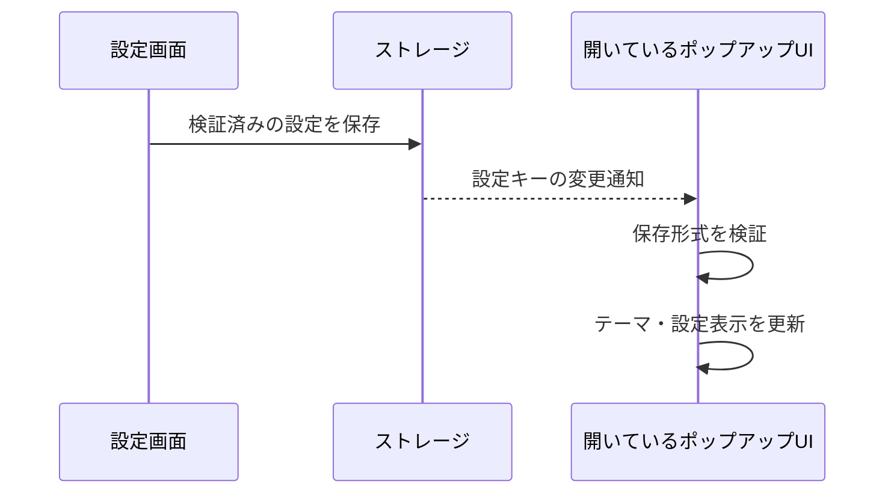
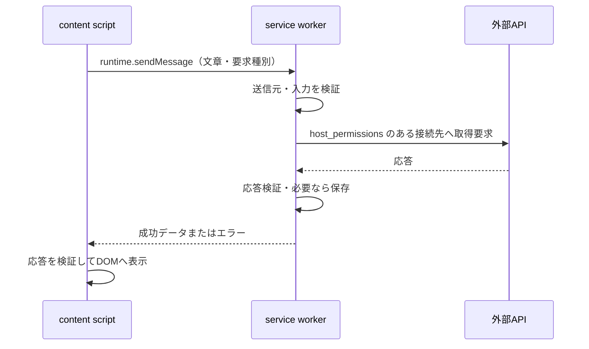

# 拡張のサンプルと実行環境

## 今あるサンプル

- ツールバーから開くポップアップ: メモ保存、REST 取得、現在のページ情報の表示。
- 選択してビルドするサイドパネル: ページを操作しながら取得・メモできる独立した画面。[専用ガイド](sidepanel.md) を参照。
- 設定画面: テーマ・選択テキスト取得の保存と、確認付きリセット。
- ストレージ変更の購読: 別画面で保存した設定を再読み込みなしで反映。
- content script: クリック時にページのタイトル・URL・選択テキストを取得。

設定・メモは拡張では `chrome.storage.local`、ブラウザプレビューでは `localStorage` に保存します。
両者のデータは共有しません。ページ取得結果はポップアップ内の表示だけに使い、保存・外部送信はしません。

## 設定とリセットを試す

1. `pnpm run dev` を起動し、表示された URL の `/options.html` を開く。
2. 「表示確認用ページを開く」で `/index.html` をもう一つのタブまたはウィンドウに開く。
3. 設定画面でテーマを「ダーク」、選択テキスト取得を OFF にして保存する。
4. 表示確認用ページへ戻ると、再読み込みせず配色と設定表示が変わる。
5. 設定画面を再読み込みしても保存した値が残る。
6. 「リセット」を押し、「初期設定に戻しますか？」でキャンセルすると設定は変わらない。
7. 確定するとテーマは「端末に合わせる」、選択テキスト取得は ON に戻る。メモは消えない。

選択テキストを OFF にすると、取得済みの選択テキストも表示から取り除きます。
編集中のメモは設定通知で上書きしません。設定画面自体に未保存の入力がある場合も入力を保持し、
他画面で変更されたことを知らせます。その後の保存は現在のフォームで上書きします。
複数画面での同時保存は最後の書き込みが優先され、トランザクションや競合の自動マージはありません。

本物の Chrome ポップアップは、別画面を操作すると閉じます。
並べて変化を確認するためのリンクは、同じ UI を通常のタブで開きます。
拡張の通常の起動方式は `action.default_popup` です。

## UI が追従する仕組み

Chrome では `chrome.storage.onChanged`、プレビューでは別ドキュメントに届く `storage` イベントを使います。
保存した画面自身は、保存 UseCase の返り値を使って表示を更新します。
購読は初期読み出しより先に登録し、遅れて返った初期値で新しい通知を上書きしないようにしています。
画面を破棄すると購読を解除します。保存データが不正なら通知を表示せずエラーを知らせます。

`SettingsChanges` は UI 向けの通知ポートです。イベント処理を UseCase のシーケンスに混ぜません。
`features/settings/gateways/storage.ts` が保存・復元・変更通知に同じ保存形式の検証を適用します。
操作の入力検証は `controllers/load.ts`・`save.ts`・`reset.ts` がそれぞれ所有します。
リセットの controller は `{ confirmed: true }` のみ受け付けます。
設定の保存形式は `{ version: 1, theme, includeSelection }`。未保存なら初期値、不明な形式ならエラーです。
現在は過去形式の移行処理を持ちません。形式を変える際は、この gateway にバージョン移行を追加してください。

## content script とは

閲覧中の Web ページ内で動く拡張のコードです。ページの DOM を読む、文章の選択を取得する、
必要に応じてページへ UI を追加する、といった処理を担当します。
ポップアップは別のドキュメントなので、そこから閲覧中のページの DOM を直接読むことはできません。
通常はページの JavaScript と分離された isolated world で動き、DOM は共有します。
画面要素の変更検知も content script の担当です。`MutationObserver` で検知し、必要なら
service worker にメッセージで保存や通知を依頼します。worker 自身は DOM を監視できません。

このサンプルは `src/content/page.ts` の自己完結した関数を、
`chrome.scripting.executeScript` の `func` としてクリック時に実行します。
宣言型の `content_scripts` や別ファイルの常駐スクリプトは登録していません。
Chrome は関数をコピーして実行するため、関数内から拡張側の変数や import を参照しないでください。

処理経路は「capture controller → 設定を読み出す UseCase → Chrome gateway → ページ内の関数 → 応答検証」です。
拡張を操作したタブへの一時的な許可 `activeTab` と、関数を実行する `scripting` を使います。
ページ取得用の全サイト常時アクセス権限は要求しません。

| ケース | このサンプルの動作 |
| --- | --- |
| 通常の HTTP(S) ページ | メインフレームのタイトル・URL・選択テキストを返す |
| 選択なし／選択テキスト取得 OFF | 選択テキストは空。OFF なら選択自体を読まない |
| input / textarea / contenteditable にフォーカス中 | フォームや編集領域の選択テキストを取得しない |
| 長いタイトル／選択テキスト | タイトルは 512 文字、選択は 2,000 文字まで。選択の省略を画面に明示 |
| chrome://、拡張自身、file:// など | 対象外としてエラーを表示 |
| Chrome Web Store 等の保護ページ、タブ消失・権限失効 | 注入失敗を画面に表示 |
| iframe 内の選択、PDF ビューアー、特殊なページ | 対応対象外。全フレーム取得や専用 API は未実装 |
| SPA の画面遷移 | ボタンを押した時点の値を読む。自動監視はしない |

あらゆるページに対応したスクレイピング実装ではありません。派生プロジェクトでは、
対象サイト・フレーム・取得範囲・権限を決めて gateway と content script を拡張してください。
ページ由来の文字列は `textContent` で表示し、HTML として挿入しません。

## service worker とは

Manifest V3 で拡張のバックグラウンド処理を担当する、イベント駆動の実行環境です。
ポップアップを閉じていても、登録したイベントをきっかけに起動できます。
ページの DOM は持たず、常駐プロセスでもありません。処理がなくなると停止し、後で再起動します。
長時間のタスクが常に動き続ける保証はありません。

主な用途は次の通りです。

- `chrome.alarms` を契機に情報を取得する。
- `chrome.contextMenus` の右クリック操作を処理する。
- content script からの要求を受け、拡張側の API 操作や保存をまとめて処理する。
- タブの作成・更新などのブラウザイベントを処理する。
- 拡張のインストール・更新時の初期化を行う。

タイマーやグローバル変数だけに永続状態を保持せず、必要な状態は storage に保存します。
再起動後にイベントを受けられるよう、リスナーはスクリプトのトップレベルで登録します。

### メッセージ通信は何のためか

通常は「service worker 同士」ではなく、**ポップアップ／content script と service worker の間**の通信です。
実行場所ごとに使える DOM・API と生存期間が異なるため、メッセージで処理を依頼し、結果を返します。

例えば、ページで選んだ文章を外部 API で変換して表示する拡張なら、次の構成が考えられます。
これは派生機能の設計例で、現在のベースには未搭載です。

一回の要求と応答は `runtime.sendMessage`、worker から特定タブへ送るなら `tabs.sendMessage`、
継続的なやり取りなら `runtime.connect` の port を検討します。
型定義だけで信頼せず、受信時に入力と送信元、呼び出し元でも応答を検証します。
失敗・タイムアウト・ページ遷移時の切断も扱う必要があります。

ポップアップ版は、一回のページ取得と storage の変更通知で完結し、service worker を持ちません。
サイドパネル版には、ツールバーから開く動作を設定する service worker を含めています。
ページ取得や保存を worker に転送する独自メッセージ通信は追加していません。
REST API を呼ぶことだけを理由に service worker を必須にはしていません。

## 検証範囲

現在の Vitest は共通基盤の契約とビルドされた拡張の構成を確認します。
必須テストでは、設定項目やページ取得結果など、差し替えるサンプル固有の仕様を固定しません。
別途 `tests/examples/` に、参考にしたら削除する前提の任意実行テストを用意しています。
対象の詳細は [テスト方針](testing.md) を参照してください。
サンプル実装時には Chromium の通常ブラウザプレビューで、設定とポップアップ UI を別ページで開き、
保存・永続化・キャンセル／確定・通知反映・入力保持・設定破損からの復旧を確認しています。
ページ情報取得関数も通常ページの DOM で確認しています。

このクラウド環境では追加拡張の読み込みが管理ポリシーで禁止されているため、
`activeTab` の許可・実際の `executeScript` 注入・拡張版 storage 通知・ツールバーポップアップの実動作は未検証です。
プレビューの取得ボタンは固定データを返し、「プレビュー」と明記します。
実装は拡張用にも用意してあり、権限が許可された Chrome で `dist/popup/` または `dist/sidepanel/` を読み込んで確認できます。

参考: [content scripts](https://developer.chrome.com/docs/extensions/develop/concepts/content-scripts)、
[service workers](https://developer.chrome.com/docs/extensions/develop/concepts/service-workers)、
[messaging](https://developer.chrome.com/docs/extensions/develop/concepts/messaging)、
[activeTab](https://developer.chrome.com/docs/extensions/develop/concepts/activeTab)。
