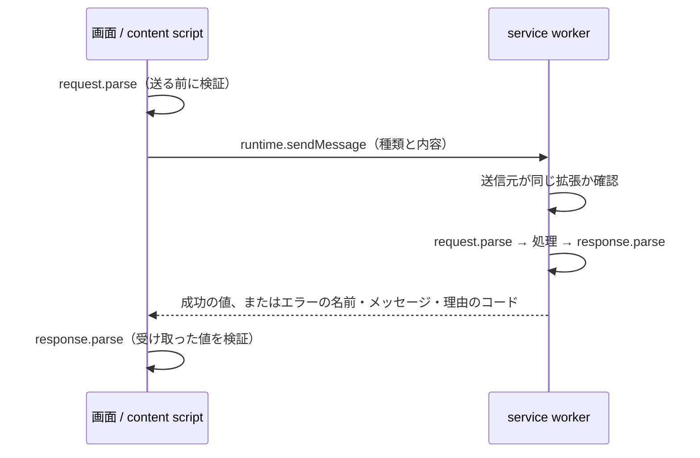

# service worker・メッセージ通信・メニュー・ショートカット・アラーム

ポップアップ版とサイドパネル版の両方に、同じ処理を登録する service worker を含めています。
ベースが用意するのは、機能に依存しない受け渡しの仕組みと、機能ごとに処理を登録する場所です。
新しい処理は「メッセージ・メニュー項目・ショートカット・アラーム・インストール時の処理を定義して composition に登録する」だけで追加でき、
worker の起動処理そのものを書き換える必要はありません。

## 配置

| 配置 | 責務 |
| --- | --- |
| `background/worker.ts` | `startWorker()`。メッセージの受信口・右クリックメニュー・ショートカット・アラーム・インストール時の処理を登録し、共有のバッジを描き直す |
| `background/popup.ts` / `background/sidepanel.ts` | 方式ごとの worker の入口。サイドパネル版はパネルの起動設定を追加する |
| `composition/worker.ts` | worker の router・共有のバッジと、メニュー項目・ショートカット・アラーム・インストール時の処理の一覧。各機能の登録関数を呼ぶ |
| `composition/<機能>.ts` | 機能の組み立てと、worker への登録（例: `composition/notes.ts` の `registerNoteWorker`） |
| `infrastructure/messaging/` | メッセージの契約・router・client・Chrome の受信口。機能を知らない |
| `infrastructure/context-menus.ts` | メニュー項目の作成と、クリックの振り分け |
| `infrastructure/commands.ts` | ショートカットの振り分け |
| `infrastructure/alarms.ts` | アラームの作成と振り分け、一度だけのアラームの予約 |
| `infrastructure/lifecycle.ts` | インストール・更新時の処理の呼び出し |
| `infrastructure/badge.ts` | ツールバーのバッジ。機能ごとの枠を持つ共有のバッジと、タブごとのバッジ |
| `infrastructure/page-toast.ts` | ページ上の通知。Shadow DOM でページの CSS から隔離する |
| `infrastructure/page-scripts.ts` | ビルドした content script をタブで実行する |
| `content/<名前>.ts` | ページに注入する content script の入口。`content/<名前>.js` として出力される |
| `features/notes/gateways/worker.ts` | 取り込みを worker に依頼するサンプルのメッセージと gateway |

ビルドでは方式ごとの入口が `worker.js` として出力され、manifest の `background.service_worker` に登録されます。

## worker の制約

ポップアップや設定画面と違い、worker は画面を持たず、必要なときだけ起動します。
次の制約を守らないと、再起動後にイベントを取りこぼしたり、状態が消えたりします。

- **リスナーは最上位で同期的に登録する**。worker を起こしたイベントは、起動直後の最初の実行中に
  登録されたリスナーにしか届きません。`await` の後や `setTimeout` の中で登録しないでください。
  `startWorker()` は入口ファイルの最上位で呼び、その中も同期的に登録します。
- **状態を変数に持たない**。worker はしばらく処理がないと停止し、次のイベントで最初から起動し直します
  （Chrome では無操作が約 30 秒続くと停止します）。残す必要がある値は `chrome.storage` に保存します。
- **DOM はない**。`document`・`window`・`localStorage` は使えません。`src/ui` や Solid を import しないでください。
  画面と共有するのは features・infrastructure・integrations のコードだけです。
- **動的 `import()` は使えない**。service worker では動的 import が禁止されています。必要なモジュールは静的に import します。
- **通信の待ちは停止までの時間を延ばさない**。再試行を使う場合は、時間切れ・回数・待ち時間の合計が
  30 秒を十分に下回るようにします（`createRetryPolicy` の `maxElapsedMs`）。サンプルは 1 回 8 秒・時間切れを含めて合計 20 秒以内です。
- **長時間の処理を前提にしない**。イベントや拡張 API の呼び出しで停止までの時間は延びますが、
  長い処理は分割し、途中経過を storage に保存してください。

参考: [service worker のライフサイクル](https://developer.chrome.com/docs/extensions/develop/concepts/service-workers/lifecycle)、
[イベントの扱い](https://developer.chrome.com/docs/extensions/develop/concepts/service-workers/events)。

## メッセージ通信

画面や content script から worker に処理を依頼し、結果を受け取る仕組みです。
画面を閉じても続けたい処理や、worker にまとめたい処理に使います。

### 契約

`MessageContract<Request, Response>` は、メッセージの種類と、要求・応答のバリデーターの組です。
保存の `StorageContract` と同じく、両方のバリデーターが必須です。片方だけでは登録時に拒否します。

```ts
export const exampleMessage: MessageContract<{ id: number }, { title: string }> = {
  type: "example.fetch",            // 機能名.操作名。拡張内で一意にする
  request: { parse(raw) { /* 構造を検証して { id } を返す */ } },
  response: { parse(raw) { /* 構造を検証して { title } を返す */ } },
};
```

送受信の両側で検証します。



処理で発生したエラーは、名前・メッセージと、文字列の `reason`（機能の理由のコード）があればそれも呼び出し側に届き、
`MessageError` として投げられます。元の名前は `remoteName`、理由は `reason` で確認できます。
エラーのクラスやその他のプロパティは届かないため、画面に理由を伝えたい場合は gateway が `remoteName` と `reason` から
機能のエラーを作り直します（例: `features/notes/gateways/worker.ts`）。

### 追加する手順

1. 契約を、その処理を所有する機能の gateway に定義します（例: `features/<機能>/gateways/worker.ts`）。
2. worker 側の処理を、その機能の composition（`composition/<機能>.ts`）の登録関数で登録し、`composition/worker.ts` から呼びます。
   処理には検証済みの要求と送信元（`url`・`tabId`）が渡ります。

   ```ts
   router.handle(exampleMessage, (input, sender) => feature.fetchTitle(input));
   ```

3. 呼び出し側は client で送ります。画面からメッセージを直接送らず、port を実装した gateway として composition で注入します。

   ```ts
   const client = createMessageClient(createChromeTransport(chrome.runtime));
   const title = await client.request(exampleMessage, { id: 1 });
   ```

業務上の入力検証は、これまでどおり controller が担当します。サンプルの `notes.import` は、要求のバリデーターを
「そのまま渡す」と明示し、worker 側で取り込みの controller に検証させています。応答はメモの形式で検証します。

### 送信元の扱い

受信口は同じ拡張からのメッセージだけを処理します（`sender.id` が自分の拡張 ID と一致するもの）。
content script も同じ拡張として届くため、ページ由来の値は信用せず、要求のバリデーターと controller で検証してください。
外部の Web ページや他の拡張からの受信（`externally_connectable`・`runtime.onMessageExternal`）は登録していません。

一回の要求と応答（`runtime.sendMessage`）だけを実装しています。worker から特定のタブへ送る `tabs.sendMessage`、
継続的なやり取りの `runtime.connect` が必要になったら、同じ契約を使う受信口を `infrastructure/messaging/drivers` に追加します。

## 右クリックメニュー

機能の登録関数で、`composition/worker.ts` から渡される `menus` に `ContextMenuItem` を追加します。

```ts
{
  id: "example.open",               // 拡張内で一意にする
  title: t("exampleMenuTitle"),     // 表示名は _locales の文言を使う
  contexts: ["page", "link"],
  async onClick(click) {            // selectionText・pageUrl・tabId は型だけを検証した値
    await feature.handle(click);
  },
}
```

- 項目はインストール・更新・拡張の再読み込み時（`runtime.onInstalled`）に作り直します。Chrome が項目を保存するため、
  worker が再起動しても作り直す必要はありません。
- クリックは最上位で登録した `contextMenus.onClicked` が受け取り、ID で項目に振り分けます。
- `contextMenus` 権限を両方式の manifest に含めています。
- クリック情報のうち `selectionText` や `pageUrl` はページ由来の値です。表示や保存の前に、処理側で検証してください。
- worker には画面がないため、処理の失敗は `composition/worker.ts` の `report` でログに出ます。
  利用者への結果は、下のバッジとページ上の通知で示します。

## キーボードショートカット

キーと説明は manifest の `commands` に宣言し、処理は機能の登録関数で `commands` に `CommandItem` を追加します。

```json
"commands": {
  "_execute_action": { "suggested_key": { "default": "Ctrl+Shift+Y", "mac": "Command+Shift+Y" }, "description": "__MSG_commandOpen__" },
  "example-run": { "suggested_key": { "default": "Ctrl+Shift+U", "mac": "Command+Shift+U" }, "description": "__MSG_exampleCommand__" }
}
```

```ts
worker.commands.push({
  name: "example-run",              // manifest の commands のキーと同じ名前
  async run({ tabId, url }) {       // 押したときのアクティブタブ。タブがなければ undefined
    await feature.handle({ tabId });
  },
});
```

- `_execute_action` はベースの宣言で、ツールバーのボタンを押したのと同じ動作をします（ポップアップ版はポップアップを開きます。
  サイドパネル版はパネルを開く設定に従います。実際のキー操作は未検証です）。処理の登録は不要で、`commands.onCommand` には届きません。
- キーを押すと、そのタブに `activeTab` が付きます。`activeTab` 権限があれば、host permission なしでそのタブに `executeScript` できます。
- `suggested_key` は既定の割り当てで、他の拡張と衝突すると割り当てられません。利用者は `chrome://extensions/shortcuts` で変更できます。
  `suggested_key` を指定できるのは 4 つまでです（`_execute_action` を含む）。
- 処理の失敗は `report` でログに出ます。名前が重複した項目は登録時に拒否します。

参考: [chrome.commands](https://developer.chrome.com/docs/extensions/reference/api/commands)。

## アラーム（定期的な処理と、時間をおいた処理）

worker は停止するため、`setTimeout`・`setInterval` は残りません。時間で動かす処理は `chrome.alarms` で worker を起こします。
機能の登録関数で、`composition/worker.ts` から渡される `alarms` に `AlarmItem` を追加します。

```ts
worker.alarms.push({
  name: "example.refresh",          // 拡張内で一意にする
  periodInMinutes: 30,              // 繰り返す間隔
  firstDelayInMinutes: 1,           // インストール後の初回（省略時は periodInMinutes）
  async run({ scheduledTime }) { await feature.refresh(undefined); },
});
```

- 繰り返すアラームは、インストール・更新・ブラウザの起動時（`runtime.onInstalled`・`onStartup`）に、
  同じ名前・同じ間隔のものがなければ作ります。Chrome はアラームを保持しますが、更新や再起動で消えることがあるためです。
- 一度だけのアラームは、機能が `createAlarmScheduler(chrome.alarms)` の `schedule(name, 分)` で予約し、`cancel(name)` で取り消します。
  同じ名前で予約し直すと置き換わります。鳴ったときの処理は、同じ名前で `alarms` に登録します（`periodInMinutes` は付けません）。
- 間隔・遅延は 30 秒（0.5 分）以上です。Chrome はそれより短い指定を 30 秒に切り上げるため、登録時に拒否します。
- 鳴る時刻は正確ではなく、PC がスリープ中なら復帰後に鳴ります。時刻に依存する処理は、`scheduledTime` や保存した時刻で判断します。
- `alarms` 権限が必要です（インストール時の警告はありません）。登録した項目がないとき、ベースは `chrome.alarms` を使いません。

参考: [chrome.alarms](https://developer.chrome.com/docs/extensions/reference/api/alarms)。

## インストール・更新時の処理

`installs` に `InstallTask` を追加すると、`runtime.onInstalled` で呼ばれます。理由（`reason`）と、更新なら前のバージョンが渡ります。

```ts
worker.installs.push({
  name: "example.welcome",
  async run({ reason, previousVersion }) {
    if (reason === "install") await chrome.tabs.create({ url: chrome.runtime.getURL("welcome.html") });
  },
});
```

- `reason` は `install`（新規）・`update`（拡張の更新・再読み込み）・`chrome_update`（Chrome の更新）などです。
  案内ページのように一度だけ見せたいものは `install` に限ります。開発中の拡張の再読み込みは `update` です。
- 保存形式を変えたときの移し替えは、`update` で `previousVersion` を見て行えます。
- 処理は一つずつ独立して呼び、一つが失敗しても他の処理は続けます。失敗は `report` でログに出ます。

## バッジ

ツールバーのボタンに短い文字を出す部品で、二種類あります。どちらも文言や表示の条件を知らず、機能の composition が選んで渡します。

```ts
// 共有のバッジ: 複数の機能が枠（slot）を持ち、優先度の高い枠が表示される
const count = worker.badges.slot("example.count", 20);
await count.show("3", "#1f7a5c");   // 文字は 4 文字程度まで
await count.clear();

// タブごとのバッジ: そのタブを表示している間だけ、共有のバッジより優先して表示される
const tabBadge = createTabBadge(chrome.action);
await tabBadge.show(tabId, "!", "#ad334a");
await tabBadge.clear(tabId);
```

- **共有のバッジ**（`createBadgeBoard`）: 件数とリマインダーのように、複数の機能が同時に使えるよう、機能ごとの枠を storage（`action-badge`）に保存し、
  優先度（数値が大きいほど優先）の最も高い枠を表示します。枠を消すと次の枠が表示されます。
  画面からも同じ枠を消せます（例: 画面を開いたらリマインダーを消す）。worker は起動のたびに storage から描き直します。
  Chrome はブラウザの再起動でバッジを消すためです。
- **タブごとのバッジ**（`createTabBadge`）: そのタブで起きたこと（例: 追加の失敗）を示します。タブを閉じると消えます。
- 優先度は各機能の composition が決めます。サンプルはコーヒーの新着が 20、メモのリマインダーが 10 です。

## ページ上の通知と content script

worker からページに出す通知は、二つの方法があります。

```ts
// 1. 関数を注入する: 文言を渡して表示するだけの通知
const toasts = createPageToasts(chrome.scripting);
const shown = await toasts.show(tabId, t("exampleDone"), "success"); // 実行できないページでは false

// 2. ビルドした content script を注入する: ボタンを押したら worker に依頼する、などのやり取りがある通知
const scripts = createPageScripts(chrome.scripting);
await scripts.run(tabId, "content/example.js");                       // src/content/example.ts から出力される
```

- 通知は、ページに要素を一つ追加し、closed の Shadow DOM の中に表示します（`renderPageToast`）。
  ページの CSS は中に届かず、外側の要素もスタイルを `!important` で初期化するため、ページの指定で隠れたり動いたりしません。
  文言は `textContent` で入れ、HTML として解釈しません。数秒後に自動で消え、ポインターが乗っているかフォーカスがある間は消えません。
  OS のライト／ダークと「視差効果を減らす」に従います。
- **関数の注入**（1）: Chrome が関数を文字列にして送るため、import や外側の変数を使えず、ボタンの処理（関数）も渡せません。
- **content script**（2）: `src/content/<名前>.ts` は、ビルドで `content/<名前>.js` に、import したコードごと一つのファイルにまとめて出力されます
  （`vite.config.ts` の `content-scripts`）。メッセージの client や機能の gateway を import でき、`renderPageToast` の第 4 引数でボタンを付けられます。
  `src/ui`・Solid・動的 import には届かないようにビルドで確認します。
- どちらもそのタブへの実行権限が必要です（`scripting` と、`activeTab` または host permission）。
  `chrome://` のページや Chrome Web Store などでは実行できず、`false` を返します。バッジは権限なしで表示できます。
- content script は利用者のページの中で動くため、ページから信用できる値を受け取る経路にはしません。
  worker への依頼は通常のメッセージと同じく、要求のバリデーターと controller が検証します。
- manifest の `content_scripts` で全ページに常駐させる方法は、インストール時に「すべてのサイトのデータの読み取りと変更」の警告が出るため使っていません。
  必要なときだけ、利用者の操作で付く `activeTab` で注入します。

## サンプル

- **REST の取り込み**: 画面の `importNote` は、拡張では worker に `notes.import` を依頼します。
  ポップアップを閉じても worker が取得から保存まで完了します。ブラウザプレビューには worker がないため、画面内で実行します。
- **選択した文章をメモに追加**: 文章を選んで右クリックするか `Ctrl+Shift+U`（Mac は `⌘+Shift+U`）を押すと、
  worker がメモの末尾に追加し、ページに結果を通知します。ショートカットは `scripting` でタブの選択を読みます（入力欄の選択は除きます）。
  選択がない、または追加後に 2,000 文字を超える場合は保存せず、通知とそのタブの `!` のバッジで示します。バッジはそのタブで次に成功すると消えます。
- **ページの通知から元に戻す**（content script → worker）: 追加に成功すると、worker が `content/append-notice.js` をタブに注入します。
  通知の「元に戻す」を押すと、content script が `notes.undoAppend` を worker に送り、worker が追加前のメモに戻します。
  追加の後にメモが書き換えられていたら戻さず、その旨を通知します。戻せるのは直前の追加を一度だけです。
- **コーヒーの新着**（繰り返すアラーム）: 30 分ごとに SampleAPIs のコーヒー一覧を取得し、前回見てから増えた件数を共有のバッジに出します。
  初回（インストールの 1 分後）は一覧を記録するだけで、件数は数えません。画面の「コーヒーの新着」を開くと一覧を表示して既読にし、バッジを消します。
  「今すぐ確認」は worker に `arrivals.check` を依頼します。
- **メモの見直しリマインダー**（一度だけのアラーム）: メモが保存されるたびに、60 分後のアラームを予約し直します（空にしたら取り消します）。
  鳴ると共有のバッジに `●` を出し、画面を開くと消えます。worker は storage の変更通知でどの画面からの保存も受け取ります。通信はしません。
- **インストール時の案内ページ**: 新規インストールのときだけ `welcome.html` を開きます。Chrome が実際に割り当てたショートカットのキー
  （`commands.getAll`）と、変更画面（`chrome://extensions/shortcuts`）を開くボタンを表示します。更新や再読み込みでは開きません。
- **開いている画面の追従**: 画面はメモの保存を storage の変更通知で受け取り、表示を更新します。
  編集中の下書きがあるときは上書きせず、別の画面で更新されたことを知らせます。その後の保存は下書きで上書きします。

## 開発と確認

- worker のログは `chrome://extensions` の拡張のカードにある「Service Worker」のリンクから DevTools で確認します。
- worker やメニュー項目を変更したら、拡張管理画面で拡張を再読み込みしてください。再読み込みでメニュー項目も作り直されます。
- 必須テストは `tests/infrastructure/` の `messaging`・`context-menus`・`commands`・`alarms`・`lifecycle`・`badge` で、仕組みの契約だけを確認します。
- worker や content script から `src/ui`・Solid・動的 import に届くとビルドが失敗します（`vite.config.ts` の `worker-boundary`・`content-scripts`）。
- アラームを待たずに確認するには、worker の DevTools で `chrome.alarms.onAlarm.dispatch({ name: "arrivals.check", scheduledTime: Date.now() })` のように発火させます（E2E テストと同じ方法。`dispatch` は Chrome 内部の仕組みで、公式の API ではありません）。
- 実際の Chromium に拡張を読み込んだ確認の範囲は [拡張サンプルのガイド](extension.md#検証範囲) にあります。
