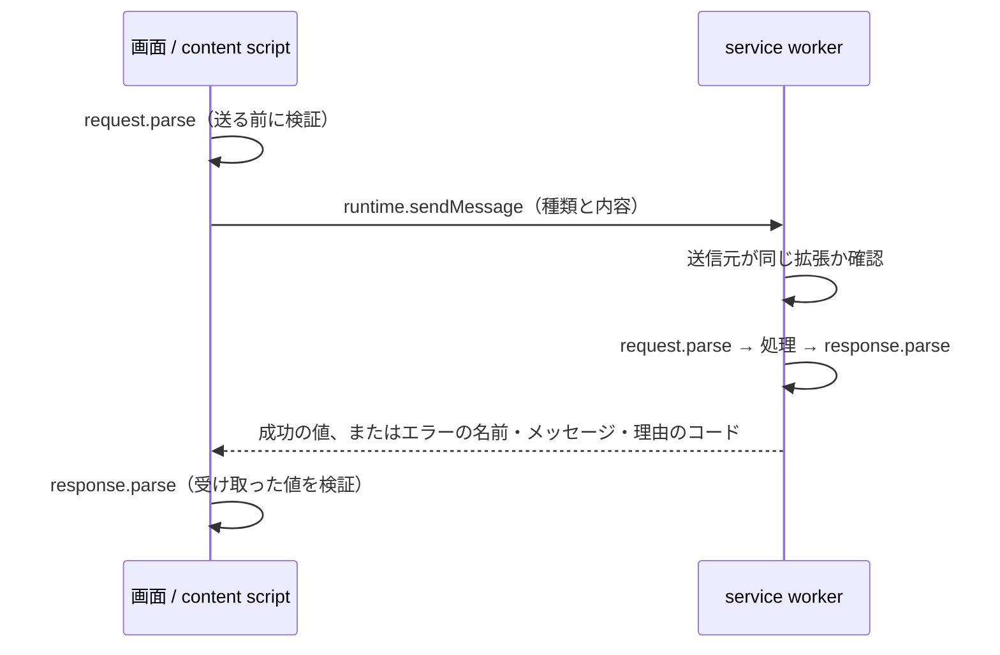

# service worker・メッセージ通信・右クリックメニュー

ポップアップ版とサイドパネル版の両方に、同じ処理を登録する service worker を含めています。
ベースが用意するのは、機能に依存しない受け渡しの仕組みと、機能ごとに処理を登録する場所です。
新しい処理は「メッセージやメニュー項目を定義して composition に登録する」だけで追加でき、
worker の起動処理そのものを書き換える必要はありません。

## 配置

| 配置 | 責務 |
| --- | --- |
| `background/worker.ts` | `startWorker()`。メッセージの受信口と右クリックメニューを登録する |
| `background/popup.ts` / `background/sidepanel.ts` | 方式ごとの worker の入口。サイドパネル版はパネルの起動設定を追加する |
| `composition/worker.ts` | worker の router とメニュー項目の一覧。各機能の登録関数を呼ぶ |
| `composition/<機能>.ts` | 機能の組み立てと、worker への登録（例: `composition/notes.ts` の `registerNoteWorker`） |
| `infrastructure/messaging/` | メッセージの契約・router・client・Chrome の受信口。機能を知らない |
| `infrastructure/context-menus.ts` | メニュー項目の作成と、クリックの振り分け |
| `features/notes/gateways/worker.ts` | 取り込みを worker に依頼するサンプルのメッセージと gateway |

ビルドでは方式ごとの入口が `worker.js` として出力され、manifest の `background.service_worker` に登録されます。

## worker の制約

ポップアップや設定画面と違い、worker は画面を持たず、必要なときだけ起動します。
次の制約を守らないと、再起動後にイベントを取りこぼしたり、状態が消えたりします。

- **リスナーは最上位で同期的に登録する**。worker を起こしたイベントは、起動直後の最初の実行中に
  登録されたリスナーにしか届きません。`await` の後や `setTimeout` の中で登録しないでください。
  `startWorker()` は入口ファイルの最上位で呼び、その中も同期的に登録します。
- **状態を変数に持たない**。worker はしばらく処理がないと停止し、次のイベントで最初から起動し直します
  （Chrome では無操作が約 30 秒続くと停止します）。残す必要がある値は `chrome.storage` に保存します。
- **DOM はない**。`document`・`window`・`localStorage` は使えません。`src/ui` や Solid を import しないでください。
  画面と共有するのは features・infrastructure・integrations のコードだけです。
- **動的 `import()` は使えない**。service worker では動的 import が禁止されています。必要なモジュールは静的に import します。
- **通信の待ちは停止までの時間を延ばさない**。再試行を使う場合は、時間切れ・回数・待ち時間の合計が
  30 秒を十分に下回るようにします（`createRetryPolicy` の `maxElapsedMs`）。サンプルは 1 回 8 秒・時間切れを含めて合計 20 秒以内です。
- **長時間の処理を前提にしない**。イベントや拡張 API の呼び出しで停止までの時間は延びますが、
  長い処理は分割し、途中経過を storage に保存してください。

参考: [service worker のライフサイクル](https://developer.chrome.com/docs/extensions/develop/concepts/service-workers/lifecycle)、
[イベントの扱い](https://developer.chrome.com/docs/extensions/develop/concepts/service-workers/events)。

## メッセージ通信

画面や content script から worker に処理を依頼し、結果を受け取る仕組みです。
画面を閉じても続けたい処理や、worker にまとめたい処理に使います。

### 契約

`MessageContract<Request, Response>` は、メッセージの種類と、要求・応答のバリデーターの組です。
保存の `StorageContract` と同じく、両方のバリデーターが必須です。片方だけでは登録時に拒否します。

```ts
export const exampleMessage: MessageContract<{ id: number }, { title: string }> = {
  type: "example.fetch",            // 機能名.操作名。拡張内で一意にする
  request: { parse(raw) { /* 構造を検証して { id } を返す */ } },
  response: { parse(raw) { /* 構造を検証して { title } を返す */ } },
};
```

送受信の両側で検証します。



処理で発生したエラーは、名前・メッセージと、文字列の `reason`（機能の理由のコード）があればそれも呼び出し側に届き、
`MessageError` として投げられます。元の名前は `remoteName`、理由は `reason` で確認できます。
エラーのクラスやその他のプロパティは届かないため、画面に理由を伝えたい場合は gateway が `remoteName` と `reason` から
機能のエラーを作り直します（例: `features/notes/gateways/worker.ts`）。

### 追加する手順

1. 契約を、その処理を所有する機能の gateway に定義します（例: `features/<機能>/gateways/worker.ts`）。
2. worker 側の処理を、その機能の composition（`composition/<機能>.ts`）の登録関数で登録し、`composition/worker.ts` から呼びます。
   処理には検証済みの要求と送信元（`url`・`tabId`）が渡ります。

   ```ts
   router.handle(exampleMessage, (input, sender) => feature.fetchTitle(input));
   ```

3. 呼び出し側は client で送ります。画面からメッセージを直接送らず、port を実装した gateway として composition で注入します。

   ```ts
   const client = createMessageClient(createChromeTransport(chrome.runtime));
   const title = await client.request(exampleMessage, { id: 1 });
   ```

業務上の入力検証は、これまでどおり controller が担当します。サンプルの `notes.import` は、要求のバリデーターを
「そのまま渡す」と明示し、worker 側で取り込みの controller に検証させています。応答はメモの形式で検証します。

### 送信元の扱い

受信口は同じ拡張からのメッセージだけを処理します（`sender.id` が自分の拡張 ID と一致するもの）。
content script も同じ拡張として届くため、ページ由来の値は信用せず、要求のバリデーターと controller で検証してください。
外部の Web ページや他の拡張からの受信（`externally_connectable`・`runtime.onMessageExternal`）は登録していません。

一回の要求と応答（`runtime.sendMessage`）だけを実装しています。worker から特定のタブへ送る `tabs.sendMessage`、
継続的なやり取りの `runtime.connect` が必要になったら、同じ契約を使う受信口を `infrastructure/messaging/drivers` に追加します。

## 右クリックメニュー

機能の登録関数で、`composition/worker.ts` から渡される `menus` に `ContextMenuItem` を追加します。

```ts
{
  id: "example.open",               // 拡張内で一意にする
  title: t("exampleMenuTitle"),     // 表示名は _locales の文言を使う
  contexts: ["page", "link"],
  async onClick(click) {            // selectionText・pageUrl・tabId は型だけを検証した値
    await feature.handle(click);
  },
}
```

- 項目はインストール・更新・拡張の再読み込み時（`runtime.onInstalled`）に作り直します。Chrome が項目を保存するため、
  worker が再起動しても作り直す必要はありません。
- クリックは最上位で登録した `contextMenus.onClicked` が受け取り、ID で項目に振り分けます。
- `contextMenus` 権限を両方式の manifest に含めています。
- クリック情報のうち `selectionText` や `pageUrl` はページ由来の値です。表示や保存の前に、処理側で検証してください。
- worker には画面がないため、処理の失敗は `startWorker()` の `report` でログに出ます。
  サンプルでは、失敗するとツールバーのアイコンに `!` のバッジを付け、次に成功したときに消します。

## サンプル

- **REST の取り込み**: 画面の `importNote` は、拡張では worker に `notes.import` を依頼します。
  ポップアップを閉じても worker が取得から保存まで完了します。ブラウザプレビューには worker がないため、画面内で実行します。
- **選択した文章をメモに追加**: 文章を選んで右クリックすると、worker がメモの末尾に追加します。
  追加後に 2,000 文字を超える場合は保存せず、バッジで失敗を示します。
- **開いている画面の追従**: 画面はメモの保存を storage の変更通知で受け取り、表示を更新します。
  編集中の下書きがあるときは上書きせず、別の画面で更新されたことを知らせます。その後の保存は下書きで上書きします。

## 開発と確認

- worker のログは `chrome://extensions` の拡張のカードにある「Service Worker」のリンクから DevTools で確認します。
- worker やメニュー項目を変更したら、拡張管理画面で拡張を再読み込みしてください。再読み込みでメニュー項目も作り直されます。
- 必須テストは `tests/infrastructure/messaging.test.ts` と `context-menus.test.ts` で、仕組みの契約だけを確認します。
- 実際の Chromium に拡張を読み込んだ確認の範囲は [拡張サンプルのガイド](extension.md#検証範囲) にあります。
